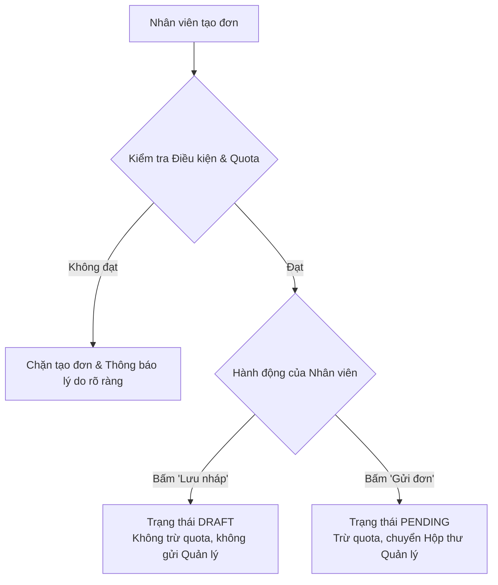

# 03 — Quản Lý Đơn Từ & Quy Trình Phê Duyệt Động (Requests & Approval Workflows)

> **Mục tiêu:** Mô tả chi tiết 4 loại đơn từ hành chính, cơ chế kiểm soát hạn mức (Quota Engine), sự khác biệt giữa Lưu nháp và Gửi đơn, ma trận phê duyệt phân tầng (Mặc định vs CA & Mobile) và cơ chế tự động chuyển cấp (Auto-escalation SLA).

---

## 1. Danh Mục 4 Loại Đơn Từ & Quy Tắc Nghiệp Vụ

Hệ thống quản lý 4 nhóm đơn chính, hỗ trợ kiểm tra điều kiện ngay tại thời điểm tạo đơn để chặn các vi phạm từ phía người dùng:

### 1.1. Đơn Đi Muộn / Về Sớm (Late Arrival / Early Departure — Screen S07)
* **Mục đích:** Khai báo khi không thể làm đủ 8 tiếng trong ngày do đến muộn hoặc về sớm.
* **Hạn mức (Quota):** Tối đa **2 lần/tháng**.
* **Thời lượng tối đa:** Không quá **60 phút/lần**.
* **Tính năng tự động điền (Smart Auto-fill):** Khi nhân viên vào form tạo đơn, hệ thống tự động đọc log check-in thực tế của ngày hôm đó (ví dụ: check-in lúc 09:42 so với mốc 09:30) $\rightarrow$ Tự điền số phút muộn: `12 phút`.
* **Chế độ hạn nộp (Cấu hình qua Rule Engine):**
  * *Chế độ 1 (Có kế hoạch):* Bắt buộc gửi trước **08:00 sáng** của ngày làm việc.
  * *Chế độ 2 (Đột xuất):* Cho phép nộp bổ sung trong ngày phát sinh sự cố kèm lý do khẩn cấp (hỏng xe, ngập lụt, tai nạn...).

### 1.2. Đơn Bổ Sung Chấm Công (Attendance Adjustment — Screen S31)
* **Mục đích:** Áp dụng khi quên chấm công vào/ra hoặc lỗi kỹ thuật.
* **Hạn mức (Quota):** Tối đa **5 lần/tháng**.
* **Hạn nộp linh hoạt (Working Days Rule):** Nộp muộn nhất trong vòng **3 ngày làm việc (Working Days)** kể từ ngày quên chấm. Hạn chót là **23:59:59 của ngày làm việc thứ 3** (Không tính thứ Bảy, Chủ nhật và ngày Lễ Tết).
* **Ràng buộc:** Bắt buộc nhập lý do chi tiết và chọn mốc giờ đề xuất bổ sung.

### 1.3. Đơn Xin Nghỉ Phép (Leave Request — Screen S30)
* **Mục đích:** Xin nghỉ phép trong năm hoặc nghỉ chế độ.
* **8 Loại nghỉ:**
  1. `AL` (Annual Leave): Nghỉ phép năm (trừ vào số dư phép năm khả dụng).
  2. `S` (Sick Leave): Nghỉ ốm hưởng BHXH/công ty $\rightarrow$ **Bắt buộc đính kèm tệp ảnh/PDF giấy khám bệnh**.
  3. `NL` (National Holiday): Nghỉ lễ tết theo lịch nhà nước (Hệ thống tự động điền theo cấu hình năm).
  4. `RO` (Rest Off): Nghỉ bù cho ngày làm việc dịp lễ.
  5. `CL` (Compassionate Leave): Nghỉ việc riêng hưởng nguyên lương (kết hôn, tang chế).
  6. `ML` (Maternity Leave): Nghỉ thai sản (6 hoặc 7 tháng).
  7. `PL` (Paternity Leave): Nghỉ khi vợ sinh (5, 7, 10 hoặc 14 ngày tùy trường hợp sinh mổ/sinh đôi).
  8. `UP` (Unpaid Leave): Nghỉ không lương (khi hết ngày phép hoặc đang thử việc).
* **Hạn nộp:** Phải đăng ký trước tối thiểu **3 ngày** (trừ trường hợp nghỉ ốm đột xuất).
* **Kiểm tra số dư:** Hệ thống đối chiếu số ngày xin nghỉ với `Số dư phép hiện tại + Hạn mức ứng trước (Leave Advance)`; nếu vượt quá sẽ tự động từ chối.

### 1.4. Đơn Làm Việc Từ Xa (Work From Home — Screen S10)
* **Mục đích:** Đăng ký làm việc tại nhà hoặc ngoài văn phòng.
* **Hạn mức (Quota):** Tối đa **2 ngày/tuần**.
* **Quy tắc chặn ngày thứ 3:** Hệ thống tự động đếm số ngày WFH đã được duyệt và đang chờ duyệt trong tuần; **chặn cứng không cho tạo đơn ngày thứ 3**.
* **Đơn vị tối thiểu:** Mỗi đơn tối thiểu **0.5 ngày** (nửa ngày).
* **Đặc quyền sau khi duyệt:** Chỉ trong ngày WFH đã được phê duyệt, nhân viên mới được phép thực hiện chấm công ngoài mạng WiFi văn phòng mà không bị gắn cờ vi phạm.

---

## 2. Quota Engine & Trạng Thái Đơn: Lưu Nháp vs Gửi Đơn

Một trong những sai lầm phổ biến của nhân viên là bấm lưu nhưng tưởng đã gửi:
* **Nút "Lưu nháp" (Save Draft):**
  * Trạng thái đơn: `DRAFT`.
  * **Không trừ hạn mức (Quota).**
  * Không xuất hiện trong Hộp thư duyệt của Quản lý.
  * Nhân viên có thể chỉnh sửa tự do bất cứ lúc nào.
* **Nút "Gửi đơn" (Submit Request):**
  * Trạng thái đơn: `PENDING_APPROVAL`.
  * **Trừ ngay hạn mức (Quota)** khả dụng trong tháng/tuần.
  * Bắn thông báo đẩy (Push/Email) và đưa vào Todo Inbox của Quản lý trực tiếp.

> **Quyền Rút đơn (Withdraw Request):** Nhân viên có quyền rút đơn khi đơn đang ở trạng thái `PENDING_APPROVAL` và Quản lý chưa thực hiện thao tác duyệt. Khi rút đơn thành công, hạn mức quota được hoàn trả lại ngay lập tức.

---

## 3. Ma Trận Phê Duyệt Động (Dynamic Approval Workflows)

Luồng duyệt được gắn chặt với **Nhóm (Team / Department)** chứ không cố định theo tên người, đảm bảo khi thay đổi nhân sự hệ thống tự động thích ứng:

| Nhóm / Đơn vị | Quy trình phê duyệt | Lý do & Nghiệp vụ đặc thù |
|---|---|---|
| **Hầu hết các phòng ban** (`Sirius`, `Optimus`, `Zeus`...) | **1 Cấp:** Quản lý trực tiếp (`line_manager_id`) $\rightarrow$ Hoàn tất. | Tối ưu tốc độ, trao quyền trực tiếp cho Lead nhóm. |
| **Nhóm CA** | **2 Cấp:** Trưởng nhóm CA (Leader) duyệt $\rightarrow$ Chuyển **HR Admin** duyệt lần 2 $\rightarrow$ Hoàn tất. | Do cấp quản lý cao hơn ở văn phòng khu vực/Thái Lan, cần HR Việt Nam hậu kiểm. |
| **Nhóm Mobile** | **2 Cấp:** Trưởng nhóm Mobile (Leader) duyệt $\rightarrow$ Chuyển **HR Admin** duyệt lần 2 $\rightarrow$ Hoàn tất. | Tương tự nhóm CA. |
| **Đơn nghỉ phép dài ngày ($\ge 5$ ngày) hoặc Thai sản** | **2 Cấp:** Quản lý trực tiếp duyệt $\rightarrow$ Chuyển **HR Admin** duyệt $\rightarrow$ Hoàn tất. | Cần HR chuẩn bị thủ tục BHXH và phân bổ nhân sự thay thế. |

---

## 4. Trải Nghiệm Duyệt Đơn Cho Quản Lý & Cơ Chế SLA (Screen S12, S13)

### 4.1. Duyệt Nhanh & Chip Hiển Thị Điều Kiện (Smart Chips)
Trong hộp thư duyệt (`S12`), mỗi lá đơn đều hiển thị trực quan các chip trạng thái để Quản lý không cần mở từng đơn:
* ✅ `Trong Quota` (Ví dụ: Còn 1/2 lượt)
* ✅ `Nộp đúng hạn`
* ❌ `Vượt 60 phút/lần`
* 📎 `Đã đính kèm giấy khám bệnh`

**Duyệt hàng loạt (Bulk Approval):** Quản lý có thể tích chọn nhiều đơn hợp lệ và bấm **[Duyệt tất cả]** để giải phóng 10–20 đơn chỉ trong vài cú click chuột.

### 4.2. Từ Chối Bắt Buộc Có Lý Do
Khi Quản lý bấm `[Từ chối]`, hệ thống vô hiệu hóa nút xác nhận cho đến khi:
* Quản lý chọn một lý do nhanh từ chip gợi ý (ví dụ: *"Trùng lịch họp quan trọng"*, *"Số lượng người trực hôm đó không đủ"*).
* Hoặc nhập lý do tùy chỉnh. Lý do này được gửi thông báo ngay cho nhân viên.

### 4.3. Cơ Chế Tự Động Chuyển Cấp Duyệt (Auto-Escalation SLA)
* Thời hạn cam kết xử lý: **48 giờ** kể từ khi đơn được gửi.
* Nếu sau 48h Quản lý trực tiếp không thao tác (do đi công tác hoặc nghỉ ốm đột xuất mà chưa kịp ủy quyền tại S37):
  * Hệ thống tự động gửi thông báo khẩn cấp (Urgent Reminder).
  * Chuyển quyền duyệt lên Quản lý cấp trên (Skip-level Manager) hoặc chuyển về Hộp thư khẩn của HR để đảm bảo không làm gián đoạn quyền lợi của người lao động.
