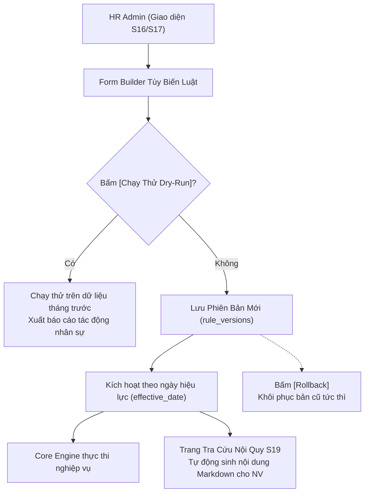

# 07 — Hệ Thống Cấu Hình Quy Định Động (Dynamic Rule Engine)

> **Mục tiêu:** Mô tả chi tiết trái tim công nghệ của hệ thống — Bộ máy cấu hình quy định (Rule Engine) quản lý toàn bộ 19 quy định nghiệp vụ thông qua dữ liệu (Data-driven Configuration), cơ chế Quản lý phiên bản (Versioning), Hoàn tác (Rollback), Chạy thử nghiệm (Dry-Run Simulator) và Trang tra cứu nội quy tự động (Screen S19).

---

## 1. Kiến Trúc Rule Engine & Nguyên Tắc Vận Hành

Trong hầu hết các phần mềm HR truyền thống, khi ban giám đốc đổi quy định (ví dụ: tăng quota đi muộn từ 2 lên 3 lần, đổi giờ làm từ 8h00 sang 8h30), phòng HR phải gửi yêu cầu sang đội IT để sửa code, test và deploy lại.

**Giải pháp của ACT HR 2026:**
* **100% Logic quy định được tham số hóa thành Dữ liệu (Configuration as Data).**
* Toàn bộ tham số được lưu trong bảng `rules` và `rule_versions`.
* Backend Engine chỉ đọc các tham số đang có hiệu lực (`is_active = true` và `NOW() >= effective_from`) để thực thi logic.

---

## 2. Danh Mục 19 Quy Định Cấu Hình Động (Rule Catalog)

| Nhóm Quy Định | Mã Tham Số (Rule Key) | Kiểu Dữ Liệu | Giá Trị Mặc Định | Mô Tả Ý Nghĩa Vận Hành |
|---|---|---|---|---|
| **1. Đơn từ** | `REQ_LATE_MONTHLY_QUOTA` | Integer | `2` | Số lần đi muộn/về sớm tối đa trong 1 tháng |
| | `REQ_LATE_MAX_MINUTES` | Integer | `60` | Số phút tối đa cho mỗi lần đi muộn/về sớm |
| | `REQ_LATE_SUBMIT_MODE` | String | `FLEXIBLE_SAME_DAY` | Chế độ nộp: `BEFORE_8AM` hoặc `FLEXIBLE_SAME_DAY` |
| | `REQ_ADJUST_MONTHLY_QUOTA` | Integer | `5` | Số lần tối đa bổ sung chấm công mỗi tháng |
| | `REQ_ADJUST_DEADLINE_DAYS` | Integer | `3` | Số ngày làm việc tối đa để gửi đơn bổ sung công |
| | `REQ_WFH_WEEKLY_QUOTA` | Integer | `2` | Số ngày làm việc từ xa (WFH) tối đa trong 1 tuần |
| | `REQ_WFH_MIN_DURATION` | Decimal | `0.5` | Thời lượng tối thiểu cho 1 lần xin WFH (0.5 ngày) |
| | `APPROVAL_SPECIAL_TEAMS` | JSON Array | `["CA", "Mobile"]`| Danh sách nhóm bắt buộc quy trình duyệt 2 cấp (Lead -> HR) |
| | `APPROVAL_SLA_HOURS` | Integer | `48` | Thời hạn tối đa Quản lý duyệt trước khi Auto-escalate |
| **2. Chấm công** | `ATTENDANCE_GEOFENCE_RADIUS` | Integer | `150` | Bán kính hợp lệ quanh tọa độ văn phòng (mét) |
| | `ATTENDANCE_GEOFENCE_WARN` | Integer | `300` | Bán kính gắn cờ cảnh báo (150m - 300m) |
| | `ATTENDANCE_OFFLINE_WINDOW_H`| Integer | `24` | Giới hạn thời gian tối đa cho phép đồng bộ offline (giờ) |
| | `ATTENDANCE_DEVICE_LIMIT` | Integer | `1` | Số lượng thiết bị di động được phép gán cho 1 nhân viên |
| | `TIMESHEET_DISPUTE_DAYS` | Integer | `2` | Số ngày làm việc cho phép nhân viên khiếu nại bảng công |
| **3. Nghỉ phép** | `LEAVE_ACCRUAL_DAY_OF_MONTH` | Integer | `15` | Ngày cộng phép năm định kỳ hàng tháng (ngày 15) |
| | `LEAVE_MANAGER_BONUS_DAYS` | Integer | `3` | Số ngày phép cộng thêm hàng năm cho cấp Quản lý |
| | `LEAVE_SENIORITY_INTERVAL_Y` | Integer | `2` | Chu kỳ thâm niên được cộng +1 ngày phép (mỗi 2 năm) |
| | `LEAVE_CARRYOVER_CAP_JULY` | Integer | `5` | Giới hạn tối đa ngày phép tồn được giữ lại từ 01/04 - 30/06 |
| | `LEAVE_ADVANCE_ALLOWED_DAYS`| Integer | `3` | Số ngày phép năm tối đa cho phép nhân viên xin ứng trước |

---

## 3. Tính Năng An Toàn: Versioning, Rollback & Dry-Run Simulator

### 3.1. Cơ Chế Quản Lý Phiên Bản & Ngày Hiệu Lực
* Mỗi khi HR lưu chỉnh sửa quy định tại `S16/S17`:
  * Hệ thống **không ghi đè trực tiếp** lên bản ghi hiện tại.
  * Tự động tạo một dòng mới trong bảng `rule_versions` với số phiên bản tăng dần (`v1.0`, `v1.1`, `v2.0`).
  * HR bắt buộc chọn trường `effective_from` (Ngày bắt đầu áp dụng) và nhập `change_reason` (Lý do thay đổi).
  * Lịch sử được lưu trữ vĩnh viễn phục vụ thanh tra lao động.

### 3.2. Tính Năng Chạy Thử Nghiệm (Dry-Run Simulator — Screen S18)
Trước khi ấn áp dụng một quy định mới (ví dụ: giảm quota WFH từ 2 ngày xuống 1 ngày/tuần), HR có thể bấm nút **[Chạy thử Dry-Run]**:
* Hệ thống lấy dữ liệu chấm công và đơn từ của tháng trước để giả lập chạy lại với bộ luật mới.
* **Báo cáo phân tích tác động (Impact Report):**
  * Có bao nhiêu nhân viên sẽ bị chuyển từ hợp lệ sang vi phạm?
  * Tổng số ngày công toàn công ty sẽ thay đổi như thế nào?
  * Cảnh báo nhóm đối tượng chịu ảnh hưởng lớn nhất.
* Giúp HR ra quyết định dựa trên dữ liệu định lượng chính xác thay vì cảm tính.

### 3.3. Cơ Chế Hoàn Tác 1-Chạm (Rollback)
Nếu quy định mới ban hành gặp phản ứng tiêu cực hoặc phát sinh lỗi vận hành:
* HR chỉ cần vào lịch sử phiên bản (`S18`), bấm nút **[Rollback về v1.0]**.
* Hệ thống kích hoạt lại tham số cũ trong 1 giây mà không cần can thiệp kỹ thuật.

---

## 4. Trang Tra Cứu Nội Quy Tự Động Cho Nhân Viên (Screen S19)

* **Loại bỏ tình trạng "Nội quy một đằng, Phần mềm chạy một nẻo":**
  * Trang `S19 - Tra cứu quy định` dành cho nhân viên không phải là trang văn bản tĩnh do HR gõ tay.
  * Nội dung được **tự động biên dịch (Auto-generated)** từ chính các tham số đang active trong Rule Engine thành văn bản tiếng Việt/Anh chuẩn mực.
  * *Ví dụ:* Khi HR đổi `REQ_LATE_MONTHLY_QUOTA` thành `3`, trang quy định của nhân viên lập tức hiển thị: *"Theo quy định hiện hành, mỗi nhân viên được phép đi muộn/về sớm tối đa 3 lần/tháng"*.
* Nhân viên có thể tìm kiếm nhanh câu hỏi thường gặp (FAQ) qua thanh tìm kiếm toàn cục `Ctrl+K`.
