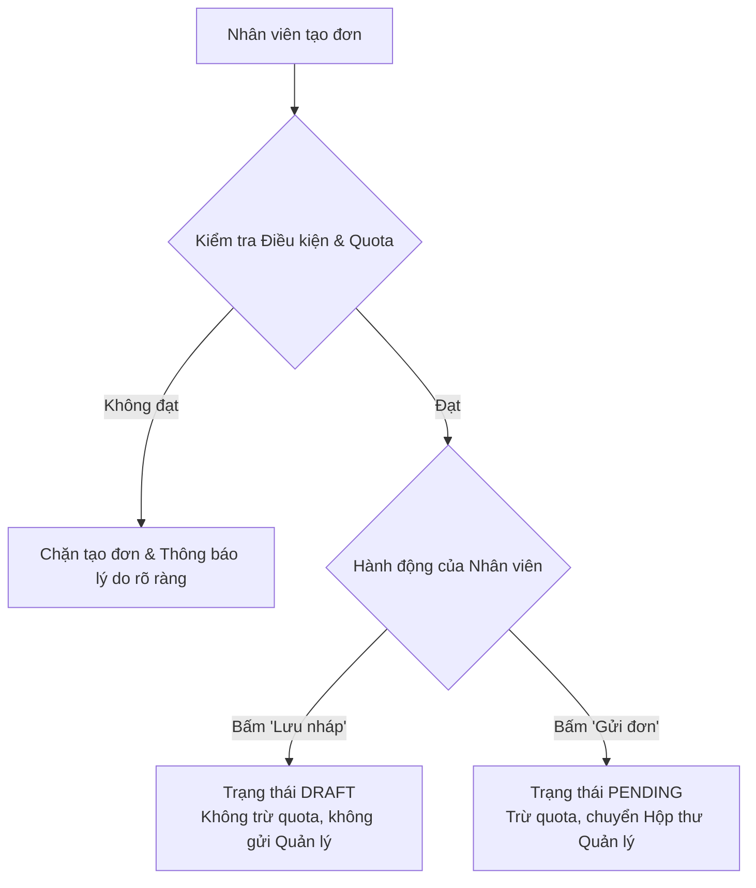

# 03 — Quản Lý Đơn Từ & Quy Trình Phê Duyệt Động (Requests & Approval Workflows)

> **Mục tiêu:** Mô tả chi tiết 4 loại đơn từ hành chính, cơ chế kiểm soát hạn mức (Quota Engine), sự khác biệt giữa Lưu nháp và Gửi đơn, ma trận phê duyệt phân tầng (Mặc định vs CA & Mobile) và cơ chế tự động chuyển cấp (Auto-escalation SLA).

---

## 1. Danh Mục 4 Loại Đơn Từ & Quy Tắc Nghiệp Vụ

Hệ thống quản lý 4 nhóm đơn chính, hỗ trợ kiểm tra điều kiện ngay tại thời điểm tạo đơn để chặn các vi phạm từ phía người dùng:

### 1.1. Đơn Đi Muộn / Về Sớm (Late Arrival / Early Departure — S07)
* **Một ngày cụ thể** (không có "từ ngày → đến ngày"). Giờ vào trong khung `checkInStart–checkInEnd` (VD 08:22 trong 08:00–09:30) **không bị coi là muộn**.
* Chọn **Đi muộn** (cập nhật giờ vào) hoặc **Về sớm** (cập nhật giờ ra) + **giờ thực tế**.
* Số phút tự tính theo ca thật (`/attendance/my-shift`): chỉ tính **đi muộn khi giờ vào > `checkInEnd`** (hết khung check-in cho phép) → phút = giờ chọn − `checkInEnd`; **về sớm khi giờ ra < `checkOutStart`** → phút = `checkOutStart` − giờ chọn. Vào/ra trong khung cho phép = 0 phút, không tạo đơn.
* **Tối đa `late_early.max_minutes`** (mặc định 60) — ô chọn giờ bị giới hạn min/max theo cấu hình; quota `late_early.max_count` (2 lần/tháng).
* **Hạn nộp `late_early.submit_within_days`** (3 ngày) — lịch chỉ chọn từ `hôm nay − N`.
* Không nhập "Số lượng/Thời lượng"; lưu `payload = { late_early, time, shift_start, shift_end }`.
* Khi quản lý **duyệt** → cập nhật `attendance_logs.check_in_at` (đi muộn) hoặc `check_out_at` (về sớm); đủ cặp giờ → `VALID`.

### 1.2. Đơn Bổ Sung Chấm Công (Attendance Adjustment — S31)
* **Một ngày cụ thể**, chỉ **hôm nay hoặc quá khứ trong `makeup.deadline_working_days`** (mặc định 3 ngày); **không cho ngày tương lai**.
* Chọn **Giờ vào (check-in)** hoặc **Giờ ra (check-out)** + **giờ thực tế**; **không nhập thời lượng**.
* Quota 5 lần/tháng, bắt buộc lý do.
* Payload lưu `{ adjust_kind: IN|OUT, time }`.
* Khi **duyệt** → cập nhật `attendance_logs` tương ứng; đủ cặp giờ → `VALID`.
* Quá hạn hoặc ngày tương lai → **400** phía server (không chỉ ẩn trên UI).

### 1.3. Đơn Xin Nghỉ Phép (Leave Request — S30)
* Loại nghỉ lấy từ `leave_types` (không hard-code), kèm `submitWithinDays`, `requiresAttachment`, đơn vị.
* **Cả ngày hoặc nửa ngày (0.5)**; nửa ngày chọn **buổi sáng/chiều**, hiển thị khung giờ làm việc thực tế còn lại theo ca.
* Ngày bắt đầu/kết thúc lưu thật vào `requests.work_date/end_date`; nhiều ngày hiển thị `dd/mm/yyyy → dd/mm/yyyy`.
* **Không giới hạn ngày tương lai** — nhân viên có thể xin nghỉ cho tháng sau/năm sau; chỉ ràng buộc hạn nộp cho ngày trong quá khứ.
* **Giấy tờ đính kèm**: loại nghỉ có `requires_attachment` bắt buộc ≥1 file (nhiều file được);ảnh/PDF, mỗi file ≤10MB; lưu nội dung thật trong `request_attachments.data (bytea)`. UI chặn gửi khi thiếu file; server chặn duyệt nếu chưa có file.
* Duyệt 1 cấp bởi quản lý trực tiếp (không qua HR). Khi duyệt → ghi 1 dòng `USED` âm vào `leave_ledger`: số ngày = số ngày làm việc (bỏ cuối tuần/lễ), nửa ngày = 0.5; nghỉ ốm (S) có dòng nhưng **không trừ phép năm**.

### 1.4. Đơn Làm Việc Từ Xa (Work From Home — S10)
* **Không giới hạn địa điểm WFH**, **không có lịch lặp tuần**.
* **Cả ngày**: chọn **từ ngày → đến ngày**; mỗi ngày làm việc trong khoảng tạo 1 đơn, chặn trước nếu vượt quota 2 ngày/tuần.
* **Nửa ngày (0.5)**: chỉ 1 ngày, chọn buổi sáng/chiều; không hiển thị khung giờ làm vì làm tại nhà.
* Cho phép đăng ký **lùi tối đa `wfh.submit_within_days` (mặc định3) ngày** (kể cả hôm nay) và **ngày tương lai không giới hạn**; quá hạn →400. Ngày WFH đã duyệt được chấm công ngoài mạng/GPS.
* Trên bảng công: `R` (cả ngày) hoặc `R/0.50` (nửa ngày); lịch nhóm hiện "WFH sáng/chiều".

### 1.5. Trùng ngày giữa đơn nghỉ phép & WFH
* Chỉ xét đơn **LEAVE/WFH** chưa hủy/chưa từ chối (PENDING_APPROVAL hoặc APPROVED).
* So khớp theo **ngày + buổi**: đơn cả ngày chiếm sáng+chiều; nửa ngày chiếm đúng buổi trong payload. Chồng lấn khi cùng ngày và cùng buổi.
* Trước khi gửi, UI gọi `POST /requests/check-conflicts`; nếu có trùng hiện **confirm** liệt kê đơn cũ + trạng thái:
  * Chọn **Hủy** → giữ đơn cũ, không tạo đơn mới.
  * Chọn **OK** → gửi kèm `replaceConflicts=true`; backend hủy đơn cũ (WITHDRAWN + lý do + audit `AUTO_CANCEL_DUPLICATE`) rồi tạo đơn mới.
* Backend tự chặn nếu client bỏ qua bước kiểm tra; áp dụng cả tạo mới và sửa đơn (exclude chính đơn đang sửa).

### 1.6. Danh sách & chi tiết đơn của nhân viên (S08)
* Phân trang **server-side** (`page`, `size`, mặc định 10/trang); tổng số đơn theo server.
* Lọc server-side: loại đơn, trạng thái, **khoảng ngày áp dụng**, từ khoá lý do.
* Cột hiển thị: Mã đơn · Loại đơn (tên loại nghỉ, không dùng mã S/AL) · **Ngày áp dụng** (1 ngày hoặc khoảng) · **Ngày tạo** · Thời lượng · Lý do · Người phê duyệt · Trạng thái · Thao tác.
* Nút **Xem chi tiết** mọi dòng → chi tiết đầy đủ + timeline + file đính kèm tải được.
* **Sửa đơn** khi đang `PENDING_APPROVAL` hoặc `REJECTED` (`PUT /requests/{id}`): cập nhật nội dung, đưa về chờ duyệt, xoá quyết định cũ; giữ file đã có và cho thêm file.
* Mỗi lần sửa ghi **audit `EDIT_REQUEST`** (trước/sau) + cập nhật lại **thời lượng** trong payload theo ngày mới; trang chi tiết (nhân viên và quản lý) hiển thị **Lịch sử chỉnh sửa**.
* Nháp: `Lưu nháp` → `Gửi duyệt` / `Hủy`; đơn bị từ chối có "Sửa & gửi lại".

## 2. Quota Engine & Trạng Thái Đơn: Lưu Nháp vs Gửi Đơn

* Quota (đi muộn2/tháng, bổ sung5/tháng, WFH2/tuần) **chỉ đếm đơn PENDING_APPROVAL hoặc APPROVED**.
* Đơn `DRAFT`, `REJECTED`, `WITHDRAWN` (kể cả tự hủy do trùng ngày) **không tính quota**.
* UI lấy số đã dùng từ `GET /requests/my-quota` (tính server-side theo tháng/tuần), không đếm trên trang đang xem.

Một trong những sai lầm phổ biến của nhân viên là bấm lưu nhưng tưởng đã gửi:
* **Nút "Lưu nháp" (Save Draft):**
  * Trạng thái đơn: `DRAFT`.
  * **Không trừ hạn mức (Quota).**
  * Không xuất hiện trong Hộp thư duyệt của Quản lý.
  * Nhân viên có thể chỉnh sửa tự do bất cứ lúc nào.
* **Nút "Gửi đơn" (Submit Request):**
  * Trạng thái đơn: `PENDING_APPROVAL`.
  * **Trừ ngay hạn mức (Quota)** khả dụng trong tháng/tuần.
  * Bắn thông báo đẩy (Push/Email) và đưa vào Todo Inbox của Quản lý trực tiếp.

> **Quyền Rút đơn (Withdraw Request):** Nhân viên có quyền rút đơn khi đơn đang ở trạng thái `PENDING_APPROVAL` và Quản lý chưa thực hiện thao tác duyệt. Khi rút đơn thành công, hạn mức quota được hoàn trả lại ngay lập tức.

---

## 3. Ma Trận Phê Duyệt Động (Dynamic Approval Workflows)

Luồng duyệt được gắn chặt với **Nhóm (Team)** chứ không cố định theo tên người, đảm bảo khi thay đổi nhân sự hệ thống tự động thích ứng:

| Nhóm / Đơn vị | Quy trình phê duyệt | Lý do & Nghiệp vụ đặc thù |
|---|---|---|
| **Hầu hết các nhóm** (`Sirius`, `Optimus`, `Zeus`...) | **1 Cấp:** Quản lý trực tiếp (`manager_id`) $\rightarrow$ Hoàn tất. | Tối ưu tốc độ, trao quyền trực tiếp cho Lead nhóm. |
| **Nhóm CA** | **2 Cấp** *(chỉ đi muộn / bổ sung công / WFH)*: Trưởng nhóm CA duyệt $\rightarrow$ **HR Admin** duyệt lần 2. Nghỉ phép vẫn 1 cấp. | Do cấp quản lý cao hơn ở văn phòng khu vực/Thái Lan, cần HR Việt Nam hậu kiểm. |
| **Nhóm Mobile** | **2 Cấp** *(chỉ đi muộn / bổ sung công / WFH)*: Trưởng nhóm Mobile duyệt $\rightarrow$ **HR Admin** duyệt lần 2. Nghỉ phép vẫn 1 cấp. | Tương tự nhóm CA. |
| **Đơn nghỉ phép (mọi loại, kể cả nghỉ dài/thai sản)** | **1 Cấp:** Quản lý trực tiếp duyệt $\rightarrow$ Hoàn tất. **Không chuyển HR.** | HR chỉ nhận thông báo để chuẩn bị thủ tục BHXH — không phải bước duyệt. |

---

## 4. Trải Nghiệm Duyệt Đơn Cho Quản Lý & Cơ Chế SLA (Screen S12, S13)

### 4.1. Duyệt Nhanh & Chip Hiển Thị Điều Kiện (Smart Chips)
Trong hộp thư duyệt (`S12`), mỗi lá đơn đều hiển thị trực quan các chip trạng thái để Quản lý không cần mở từng đơn:
* ✅ `Trong Quota` (Ví dụ: Còn 1/2 lượt)
* ✅ `Nộp đúng hạn`
* ❌ `Vượt 60 phút/lần`
* 📎 `Đã đính kèm giấy khám bệnh`

**Duyệt hàng loạt (Bulk Approval):** Quản lý có thể tích chọn nhiều đơn hợp lệ và bấm **[Duyệt tất cả]** để giải phóng 10–20 đơn chỉ trong vài cú click chuột.

### 4.2. Từ Chối Bắt Buộc Có Lý Do
Khi Quản lý bấm `[Từ chối]`, hệ thống vô hiệu hóa nút xác nhận cho đến khi:
* Quản lý chọn một lý do nhanh từ chip gợi ý (ví dụ: *"Trùng lịch họp quan trọng"*, *"Số lượng người trực hôm đó không đủ"*).
* Hoặc nhập lý do tùy chỉnh. Lý do này được gửi thông báo ngay cho nhân viên.

### 4.3. Cơ Chế Tự Động Chuyển Cấp Duyệt (Auto-Escalation SLA)
* Thời hạn cam kết xử lý: **48 giờ** kể từ khi đơn được gửi.
* Nếu sau 48h Quản lý trực tiếp không thao tác (do đi công tác hoặc nghỉ ốm đột xuất, chưa xử lý kịp):
  * Hệ thống tự động gửi thông báo khẩn cấp (Urgent Reminder).
  * Chuyển quyền duyệt lên Quản lý cấp trên (Skip-level Manager) hoặc chuyển về Hộp thư khẩn của HR để đảm bảo không làm gián đoạn quyền lợi của người lao động.
## 2. Quota Engine & Trạng Thái Đơn: Lưu Nháp vs Gửi Đơn

* Quota (đi muộn2/tháng, bổ sung5/tháng, WFH2/tuần) **chỉ đếm đơn PENDING_APPROVAL hoặc APPROVED**.
* Đơn `DRAFT`, `REJECTED`, `WITHDRAWN` (kể cả tự hủy do trùng ngày) **không tính quota**.
* UI lấy số đã dùng từ `GET /requests/my-quota` (tính server-side theo tháng/tuần), không đếm trên trang đang xem.

Một trong những sai lầm phổ biến của nhân viên là bấm lưu nhưng tưởng đã gửi:
* **Nút "Lưu nháp" (Save Draft):**
  * Trạng thái đơn: `DRAFT`.
  * **Không trừ hạn mức (Quota).**
  * Không xuất hiện trong Hộp thư duyệt của Quản lý.
  * Nhân viên có thể chỉnh sửa tự do bất cứ lúc nào.
* **Nút "Gửi đơn" (Submit Request):**
  * Trạng thái đơn: `PENDING_APPROVAL`.
  * **Trừ ngay hạn mức (Quota)** khả dụng trong tháng/tuần.
  * Bắn thông báo đẩy (Push/Email) và đưa vào Todo Inbox của Quản lý trực tiếp.

> **Quyền Rút đơn (Withdraw Request):** Nhân viên có quyền rút đơn khi đơn đang ở trạng thái `PENDING_APPROVAL` và Quản lý chưa thực hiện thao tác duyệt. Khi rút đơn thành công, hạn mức quota được hoàn trả lại ngay lập tức.

---

## 3. Ma Trận Phê Duyệt Động (Dynamic Approval Workflows)

Luồng duyệt được gắn chặt với **Nhóm (Team)** chứ không cố định theo tên người, đảm bảo khi thay đổi nhân sự hệ thống tự động thích ứng:

| Nhóm / Đơn vị | Quy trình phê duyệt | Lý do & Nghiệp vụ đặc thù |
|---|---|---|
| **Hầu hết các nhóm** (`Sirius`, `Optimus`, `Zeus`...) | **1 Cấp:** Quản lý trực tiếp (`manager_id`) $\rightarrow$ Hoàn tất. | Tối ưu tốc độ, trao quyền trực tiếp cho Lead nhóm. |
| **Nhóm CA** | **2 Cấp** *(chỉ đi muộn / bổ sung công / WFH)*: Trưởng nhóm CA duyệt $\rightarrow$ **HR Admin** duyệt lần 2. Nghỉ phép vẫn 1 cấp. | Do cấp quản lý cao hơn ở văn phòng khu vực/Thái Lan, cần HR Việt Nam hậu kiểm. |
| **Nhóm Mobile** | **2 Cấp** *(chỉ đi muộn / bổ sung công / WFH)*: Trưởng nhóm Mobile duyệt $\rightarrow$ **HR Admin** duyệt lần 2. Nghỉ phép vẫn 1 cấp. | Tương tự nhóm CA. |
| **Đơn nghỉ phép (mọi loại, kể cả nghỉ dài/thai sản)** | **1 Cấp:** Quản lý trực tiếp duyệt $\rightarrow$ Hoàn tất. **Không chuyển HR.** | HR chỉ nhận thông báo để chuẩn bị thủ tục BHXH — không phải bước duyệt. |

---

## 4. Trải Nghiệm Duyệt Đơn Cho Quản Lý & Cơ Chế SLA (Screen S12, S13)

### 4.1. Duyệt Nhanh & Chip Hiển Thị Điều Kiện (Smart Chips)
Trong hộp thư duyệt (`S12`), mỗi lá đơn đều hiển thị trực quan các chip trạng thái để Quản lý không cần mở từng đơn:
* ✅ `Trong Quota` (Ví dụ: Còn 1/2 lượt)
* ✅ `Nộp đúng hạn`
* ❌ `Vượt 60 phút/lần`
* 📎 `Đã đính kèm giấy khám bệnh`

**Duyệt hàng loạt (Bulk Approval):** Quản lý có thể tích chọn nhiều đơn hợp lệ và bấm **[Duyệt tất cả]** để giải phóng 10–20 đơn chỉ trong vài cú click chuột.

### 4.2. Từ Chối Bắt Buộc Có Lý Do
Khi Quản lý bấm `[Từ chối]`, hệ thống vô hiệu hóa nút xác nhận cho đến khi:
* Quản lý chọn một lý do nhanh từ chip gợi ý (ví dụ: *"Trùng lịch họp quan trọng"*, *"Số lượng người trực hôm đó không đủ"*).
* Hoặc nhập lý do tùy chỉnh. Lý do này được gửi thông báo ngay cho nhân viên.

### 4.3. Cơ Chế Tự Động Chuyển Cấp Duyệt (Auto-Escalation SLA)
* Thời hạn cam kết xử lý: **48 giờ** kể từ khi đơn được gửi.
* Nếu sau 48h Quản lý trực tiếp không thao tác (do đi công tác hoặc nghỉ ốm đột xuất, chưa xử lý kịp):
  * Hệ thống tự động gửi thông báo khẩn cấp (Urgent Reminder).
  * Chuyển quyền duyệt lên Quản lý cấp trên (Skip-level Manager) hoặc chuyển về Hộp thư khẩn của HR để đảm bảo không làm gián đoạn quyền lợi của người lao động.

### 4.4. Tab lịch sử duyệt (S12)
* Tab **Chờ phê duyệt** đọc `GET /requests/inbox` (PENDING_APPROVAL của cấp dưới).
* Tab **Đã phê duyệt / Bị từ chối** đọc `GET /requests/history`: đơn `APPROVED/REJECTED` của cấp dưới hoặc do chính quản lý quyết định (HR/ADMIN xem toàn công ty), có tên/mã nhân viên, ngày áp dụng, người xử lý, lý do, số giấy tờ.
* Sau khi duyệt/từ chối, UI tải lại cả inbox + history → số đếm trên 3 tab cập nhật ngay (đã test: chờ34→33, đã duyệt6→7).
* Mỗi dòng (cả3 tab) có nút **Chi tiết** và mã đơn clickable → mở trang chi tiết đơn đầy đủ thông tin, timeline, giấy tờ đính kèm.
* Bảng có **cuộn ngang** khi màn hình hẹp (min-width1150px, `overflow-x-auto`) và nút **↻ Tải lại** cạnh nút duyệt hàng loạt để refresh inbox/history.
