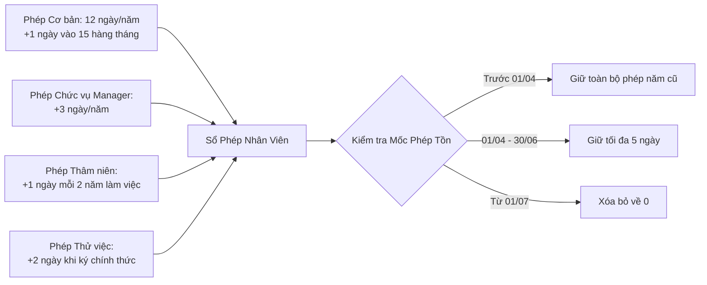

# 04 — Quản Lý Số Dư Phép & Luật Dọn Phép Tồn (Leave Balances & Accrual Engine)

> **Mục tiêu:** Mô tả chi tiết thuật toán tích lũy ngày phép năm, các chính sách cộng phép theo chức vụ và thâm niên, cơ chế ứng trước phép năm (Leave Advance), các mốc dọn phép tồn khắt khe (01/04 và 01/07), lịch cảnh báo tự động và Sổ phép (Leave Ledger) minh bạch.

---

## 1. Công Thức & Quy Tắc Tích Lũy Phép Năm (Accrual Rules)

Hệ thống tự động tính toán số dư phép năm theo 4 nguồn độc lập:

$$\text{Tổng Phép Năm Khả Dụng} = \text{Phép Cơ Bản} + \text{Phép Chức Vụ} + \text{Phép Thâm Niên} + \text{Phép Tồn} - \text{Phép Đã Dùng}$$

### 1.1. Phép Cơ Bản (Standard Annual Leave)
* **Định mức:** **12 ngày/năm**.
* **Chu kỳ cộng:** Không cấp toàn bộ 12 ngày vào đầu năm mà **cộng 1 ngày vào ngày 15 hàng tháng**.
* *Ví dụ:* Tính đến ngày 16/03, nhân viên tích lũy được $1 \times 3 = 3$ ngày phép cơ bản.

### 1.2. Phép Theo Chức Vụ (Role-based Leave)
* Cấp Quản lý (Manager trở lên) có trách nhiệm và áp lực công việc cao hơn nên được hưởng thêm **+3 ngày phép/năm**.
* Tổng định mức phép cơ bản của Quản lý là **15 ngày/năm**.

### 1.3. Phép Theo Thâm Niên (Seniority Leave)
* Căn cứ vào trường `joined_date` của nhân viên.
* Cứ mỗi **2 năm làm việc liên tục**, nhân viên được cộng thêm **+1 ngày phép**.
* Ngày cộng: Đúng vào ngày kỷ niệm tròn thâm niên 2 năm, 4 năm, 6 năm...

### 1.4. Phép Trong Thời Gian Thử Việc (Probation Leave)
* Trong 2 tháng thử việc, nhân viên tích lũy 1 ngày/tháng (tổng cộng 2 ngày).
* Trong thời gian thử việc, số ngày này ở trạng thái `LOCKED`. Nếu nghỉ sẽ tính là Nghỉ không lương (`UP`).
* Ngay khi nhân viên được chuyển sang hợp đồng chính thức: Hệ thống tự động mở khóa (unlock) và cộng dồn **+2 ngày phép** vào tài khoản.

---

## 2. Cơ Chế Ứng Trước Phép Năm (Leave Advance)

Để giải quyết các trường hợp nhân viên có việc hệ trọng (cưới hỏi, du lịch gia đình xa) vào các tháng đầu năm (khi số ngày tích lũy mới chỉ có 1–2 ngày):
* Hệ thống cho phép **Ứng trước tối đa 3 ngày phép năm** (tham số `LEAVE_ADVANCE_MAX_DAYS`).
* Số dư phép hiển thị có thể mang giá trị âm tạm thời (ví dụ: $-1.5$ ngày).
* Khi đến ngày 15 của các tháng tiếp theo, số ngày tích lũy mới sẽ tự động bù trừ cho số ngày đã ứng trước.
* **Ràng buộc an toàn:** Nếu nhân viên nộp đơn xin thôi việc khi số dư phép đang âm, hệ thống tự động tính số tiền lương tương ứng để khấu trừ vào kỳ quyết toán lương cuối cùng.

---

## 3. Quy Tắc Xóa Phép Tồn (Carry-over Expiry Rules)

Phép năm cũ chưa sử dụng hết không được bảo lưu vĩnh viễn mà được xử lý qua 3 giai đoạn:

| Giai đoạn thời gian | Quy tắc xử lý phép tồn năm trước | Trạng thái hiển thị trên App |
|---|---|---|
| **Từ 01/01 đến trước 01/04** | Cho phép **mang toàn bộ** số phép tồn của năm trước sang sử dụng. | Ưu tiên trừ phép tồn trước, sau đó mới trừ vào phép năm mới. |
| **Từ 01/04 đến trước 01/07** | **Chỉ được giữ lại tối đa 5 ngày phép tồn**. Số ngày vượt quá 5 ngày sẽ tự động bị hủy về 5. | Hiển thị huy hiệu cảnh báo vàng: *"5 ngày phép tồn hết hạn vào 30/06"*. |
| **Bắt đầu từ 01/07** | Toàn bộ số phép tồn của năm trước **bị xóa bỏ hoàn toàn về 0**. | Số phép tồn = 0. Từ mốc này chỉ được dùng phép tích lũy của năm hiện tại. |

> **Ngoại lệ đặc thù:** Hệ thống cho phép HR thiết lập cờ ngoại lệ bảo lưu đối với một số nhân sự đặc thù (ví dụ: nhân sự đi biệt phái dự án hoặc trường hợp thai sản trùng thời điểm xóa phép) kèm văn bản phê duyệt.

---

## 4. Hệ Thống Cảnh Báo Hết Hạn Phép Tự Động (Push & Email Alerts)

Để tránh khiếu nại "nhân viên không biết bị mất phép", hệ thống kích hoạt Cron Job tự động quét và gửi thông báo nhắc nhở đa kênh:

* **Mốc 1 (Trước 01/04 - Xóa phép tồn > 5 ngày):**
  * *Trước 30 ngày (01/03):* Email + Web Push (trình duyệt): *"Bạn còn X ngày phép năm cũ. Lưu ý sau ngày 31/03 bạn chỉ được giữ lại tối đa 5 ngày!"*
  * *Trước 15 ngày (15/03):* Thông báo nhắc lại.
  * *Trước 3 ngày (28/03):* Thông báo khẩn cấp (Urgent badge).
* **Mốc 2 (Trước 01/07 - Xóa toàn bộ phép tồn về 0):**
  * Tự động quét và nhắc nhở vào các ngày **01/06, 15/06 và 27/06**.

---

## 5. Sổ Phép & Truy Vết Lịch Sử (Leave Balance Audit Ledger — Screen S34)

Mọi biến động tăng/giảm số dư phép đều được lưu trữ theo mô hình **Sổ cái kế toán kép (Double-entry Ledger)** trong bảng `leave_ledger`:
* Mỗi dòng ghi nhận: `Mã NV`, `Thời điểm`, `Hành động` (+ Cấp định kỳ tháng 15, - Nghỉ AL đơn #102, + Thâm niên, - Hủy phép tồn quá hạn), `Số lượng (+/-)`, `Số dư cuối`, `Người thực hiện / Hệ thống tự động`.
* Đảm bảo tính minh bạch 100%, nhân viên và HR đều có thể tra cứu chi tiết từng ngày phép đến từ đâu và đã dùng vào ngày nào.

---

## 6. Loại Nghỉ Cấu Hình Được & Snapshot Tham Số

* **8 loại nghỉ có cột bảng công** (AL · S · NL · RO · CL · ML · PL · UP) + các loại **không có cột riêng**
  (hiếu hỉ, tang gia, thai sản nam/nữ) — HR thêm/sửa loại **không cần sửa code** (rule `leave_type_defaults`).
* Mô hình **3 tầng kế thừa**: rule chung → tham số riêng từng loại → ghi đè của một đơn.
* Đơn lưu **`applied_parameters` snapshot** lúc gửi → đổi cấu hình sau không làm sai lịch sử.
* Sổ phép (`leave_ledger`) **append-only**: chỉ thêm dòng `GRANT/USED/EXPIRED/ADJUST`, không sửa/xoá;
  điều chỉnh tay phải có lý do + người thực hiện.
* Màn hình: S32 (quản lý loại nghỉ) · S34 (sổ phép) · S09 (số dư + tổng phép còn lại).

---

## Cập nhật triển khai — 20/11/2026

* **Nguồn số dư là `leave_ledger` (append-only)**:
  * `GRANT` dương: phép năm chuẩn, phép tồn (reason chứa "bảo lưu"/"tồn"), thâm niên (reason chứa "thâm niên") — so khớp **không phân biệt hoa/thường**.
  * `USED` **âm**: mỗi lần duyệt đơn nghỉ tạo 1 dòng; nửa ngày = `-0.5`; nhiều ngày = số ngày làm việc (bỏ cuối tuần + lễ).
  * `ADJUST` ±: HR điều chỉnh tay, có lý do/người thực hiện.
* Nghỉ ốm (S) vẫn có dòng USED để tra cứu nhưng **không trừ phép năm**; phép ốm có thẻ riêng.
* `GET /leaves/my-balance` trả `granted, used, remaining, annualRemaining, carriedRemaining, seniority, adjust, sickUsed, baseAnnual, carriedGrant`.
* `GET /leaves/my-ledger` trả lịch sử; UI tính **số dư chạy** theo đúng quy tắc trên để cột “Số dư sau” khớp thẻ tổng.
* Sổ cái HR (`/attendance/leave-ledger`) hiển thị cùng running balance; bộ lọc Phép năm/Phép ốm dựa trên `leaveType` (AL/S), không dựa vào mô tả.

### Kiểm chứng C6c — 20/11/2026
* **Card số dư:** UI hiển thị tổng phép/đã dùng/còn lại + progress; các thẻ riêng Phép tồn, Phép ốm (S), Phép thâm niên. Không hiển thị thêm bảng “Số dư theo loại nghỉ” (API `byType` chỉ dùng nội bộ nếu cần).
* **Tổng phép còn lại** = `annualRemaining + carriedRemaining`; tự cập nhật sau điều chỉnh/duyệt đơn (đã test +1, -0.5).
* **Phép tồn** có card riêng + trạng thái `AVAILABLE / CAPPED / EXPIRED` theo `leave_carryover` (`max_keep_from`, `max_keep_days`, `expire_from`); test đổi rule: AVAILABLEcarry1.5 · CAPPEDcarry1 (expired0.5) · EXPIREDcarry0.
* **Cộng phép ngày15:** endpoint `POST /cron/monthly-leave-accrual` cộng1 ngày, chạy lại không cộng trùng; user vào sau ngày15 (test 20/11) **không** được cộng tháng đó.
* **Thâm niên:** sửa so sánh năm theo tháng/ngày (không dùng day-of-year do năm nhuận); test user vào20/11/2024 → cộng1 ngày đúng ngày tròn, tách khỏi kỳ cộng tháng15.
* **Sổ phép:** filter theo loại (AL/S/…) và năm lọc đúng số dòng. Mỗi dòng hiển thị **Loại phép** (tên + code) và **số dư chạy theo đúng loại đó**: AL = quỹ phép năm; S = số ngày nghỉ ốm đã dùng (không trộn với quỹ AL). Áp dụng cả Sổ phép cá nhân và Sổ cái HR.

### Cơ chế tự động (cập nhật 20/11/2026)
* **Cộng phép tháng** — `@Scheduled` **daily 02:00** (không cố định ngày15), mỗi lần chạy:
  * Đọc `leave_accrual.accrual_on` (ngày cộng, mặc định15) và số ngày/tháng = `base_days_per_year / 12` (mặc định12/12=1).
  * Chỉ user `status=ACTIVE`; bỏ qua user vào làm sau ngày cộng của kỳ đó.
  * **Catch-up:** tìm kỳ “Cộng phép tháng M/YYYY” gần nhất trong ledger, cộng bù mọi tháng thiếu tới tháng hiện tại; nếu chưa có kỳ nào thì bắt đầu tháng hiện tại (tránh cộng trùng với seed cấp năm).
  * `@EventListener(ApplicationReadyEvent)` chạy cùng logic khi khởi động → không mất kỳ nếu server tắt đúng ngày15.
  * Endpoint thủ công: `POST /cron/monthly-leave-accrual` (idempotent, trả `backfilledMonths`).
* **Cắt phép tồn** — `@Scheduled` **daily 02:15** + chạy khi khởi động, endpoint `POST /cron/leave-carry-expiry`:
  * Đọc `leave_carryover`: từ `max_keep_from` (04-01) giữ tối đa `max_keep_days` (5); từ `expire_from` (07-01) về0.
  * Tính tồn còn lại = GRANT tồn − USED **chỉ loại trừ phép năm** (S/không trừ phép không ảnh hưởng) − EXPIRED đã ghi.
  * Ghi dòng `EXPIRED` âm vào `leave_ledger` + **audit `EXPIRE_LEAVE_CARRY`**; tag theo mốc policy nên chạy lại không ghi trùng.
  * Chạy daily nên tự bù nếu lỡ ngày 01/04 hoặc 01/07.
* **Thâm niên** — daily 02:30, đọc `leave_seniority.days_per_interval` (mặc định1), cộng đúng ngày tròn, idempotent theo tag, không gộp kỳ ngày15.
* **Sổ phép** hiển thị cả dòng `EXPIRED` (Hết hạn phép tồn), tính số dư chạy theo từng loại phép.
