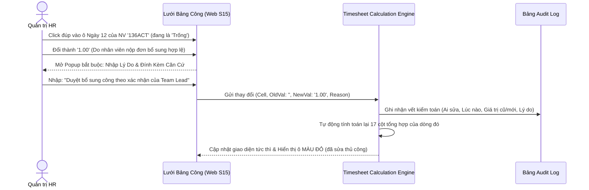

# 05 — Bảng Chấm Công 53 Cột, Sửa Tại Chỗ & Chốt Lương (Timesheet & Payroll Export)

> **Mục tiêu:** Mô tả chi tiết cấu trúc lưới bảng chấm công 53 cột (31 cột ngày + 17 cột tổng hợp) mô phỏng chính xác 100% tệp Excel thực tế của công ty ACT, ký hiệu công gốc, tính năng sửa trực tiếp trên ô (In-place edit) có audit log, quy trình khiếu nại 2 ngày và chốt khóa kỳ công.

---

## 1. Cấu Trúc Bảng Chấm Công Chi Tiết (53 Cột Chuẩn Mẫu Excel ACT)

Bảng công tháng được sinh tự động vào cuối mỗi kỳ công (từ ngày 01 đến ngày cuối cùng của tháng), gồm 2 phân vùng dữ liệu:

```
[Phân vùng 1: 31 Cột Ngày trong Tháng]  ───▶  [Phân vùng 2: 17 Cột Chỉ Số Tổng Hợp]
(Hiển thị Ký hiệu Chấm công Gốc)               (Tự động tính toán bằng Formula Engine)
```

### 1.1. Hệ Thống Ký Hiệu Chấm Công Gốc
Mỗi ô ngày trong tháng (từ ngày 1 đến ngày 31, trừ các ngày cuối tuần không có lịch làm việc) thể hiện chính xác mã ký hiệu nội bộ của công ty:

| Ký hiệu | Ý nghĩa nghiệp vụ | Giá trị công quy đổi |
|---|---|---|
| `1.00` | Đi làm đủ 8 tiếng tại văn phòng | 1.0 công |
| `0.50` | Đi làm nửa ngày (4 tiếng) tại văn phòng | 0.5 công |
| `R` | Làm việc từ xa trọn ngày (Full-day WFH) | 1.0 công (ghi nhận cờ Remote) |
| `0.50/R` | Làm việc từ xa nửa ngày (Half-day WFH) | 0.5 công Remote |
| `R/0.50` | Sáng làm WFH (0.5), Chiều làm tại văn phòng (0.5) | 1.0 công kết hợp |
| `AL` | Nghỉ phép năm trọn ngày | 1.0 ngày hưởng lương |
| `0.5/AL` | Đi làm nửa ngày, nghỉ phép nửa ngày | 0.5 công + 0.5 phép |
| `S` | Nghỉ ốm (có giấy khám bệnh) | Tính chế độ ốm đau BHXH |
| `NL` | Nghỉ lễ tết theo quy định Nhà nước | Hưởng nguyên lương |
| `RO` | Nghỉ bù | Hưởng nguyên lương |
| `CL` | Nghỉ việc riêng có lương | Hưởng nguyên lương |
| `UP` | Nghỉ không lương | 0.0 công |
| *(Trống)* | Cuối tuần (thứ 7, CN) hoặc Vắng mặt không phép (0 công) | 0.0 công |

### 1.2. 17 Cột Chỉ Số Tổng Hợp (Summary Metrics)
Hệ thống tự động tổng hợp từ 31 cột ngày bằng Formula Engine:
1. `STT`: Số thứ tự
2. `Mã NV`: Employee Code (ví dụ: `05ACT`, `136ACT`)
3. `Họ và Tên`: Full name
4. `Chức vụ`: Position
5. `Nhóm`: Team
6. `Công chuẩn`: Số ngày làm việc tiêu chuẩn trong tháng (ví dụ: 22 ngày)
7. `Công thực tế`: Tổng số công làm việc tại văn phòng
8. `Số ngày WFH (R)`: Tổng số ngày làm việc từ xa
9. `Tổng công làm việc`: `Công thực tế` + `Số ngày WFH`
10. `Số lần đi muộn / về sớm`: Đếm số lần phát sinh
11. `Tổng số phút đi muộn / về sớm`: Tổng phút vi phạm
12. `Số lần đi muộn có đơn hợp lệ`: Đã được duyệt
13. `Số lần đi muộn không có đơn`: Vi phạm trừ thưởng/đánh giá
14. `Số ngày nghỉ phép năm (AL)`
15. `Số ngày nghỉ ốm (S)`
16. `Số ngày nghỉ lễ (NL)`
17. `Số ngày nghỉ chế độ khác (CL/RO/PL/ML)`
18. `Số ngày nghỉ không lương (UP)`
19. `Tổng công tính lương cuối cùng`: Cơ sở chuyển giao phòng kế toán.

---

## 2. Tính Năng Sửa Trực Tiếp Trên Ô (In-Place Grid Edit) & Audit Log

HR không cần xuất file ra Excel rồi chỉnh tay bên ngoài mà thực hiện sửa trực tiếp ngay trên Web Portal (`S15`):



* **Audit Log Bắt Buộc:** Với mọi thao tác sửa đổi trên ô, hệ thống lưu trữ bản ghi vào bảng `timesheet_audit_logs`. Nếu người dùng không nhập lý do, nút `[Lưu]` sẽ bị disable.
* **Đánh dấu trực quan:** Ô đã bị HR sửa thủ công hiển thị **nền/viền đỏ** (`.dc.edited`); tooltip ghi *"Sửa bởi [Tên HR] lúc 14:30 02/11 — Lý do: ..."*.

---

## 3. Quy Trình 3 Giai Đoạn Chốt Bảng Công (Closing Workflow)

Quy trình chốt công theo **công bố giữa kỳ** (business `payroll_period`):

```
[1. Tạm tính]  HR/engine tổng hợp trong tháng — trạng thái draft
        ↓
[2. Công bố ngày 11]  Mở cho nhân viên xem bảng công → published
        ↓
[3. Cửa sổ khiếu nại 2 ngày]  Đến hết ngày 13 — nhân viên gửi khiếu nại
        ↓
[4. HR xử lý & khóa]  Sau khi kết thúc kỳ + 3 ngày (mặc định 03 tháng sau) → locked
        ↓
[5. Xuất Excel 53 cột]  Chỉ đọc sau khóa
```

* Ba mốc `publish_day` = 11 · `dispute_window_days` = 2 · `lock_delay_days` = 3 đều **cấu hình được** trong rule `payroll_period`.
* **Kỳ đã khóa là bản cuối cùng:** đơn nhắm kỳ đó bị **chặn từ lúc tạo**, đơn đang chờ **tự hủy**.
  **Không có cơ chế cộng/trừ bù vào kỳ sau** và không có điều chỉnh sau khóa.
* Màn hình liên quan: **S45 — Danh sách khiếu nại** (HR xử lý nhanh ngay trên bảng) và
  **S46 — Bảng phép tất cả mọi người**.

### 3.1. Quyền Khiếu Nại Của Nhân Viên (Screen S11, S33)
* Nhân viên truy cập `S11 - Bảng công của tôi` để xem chi tiết từng ngày làm việc, giờ vào/ra và các ký hiệu tương ứng.
* Nếu phát hiện sai sót (ví dụ: bị ghi nhận vắng mặt ngày có đi làm), nhân viên bấm nút `[Khiếu nại ngày này]` trong vòng **2 ngày làm việc**.
* Yêu cầu khiếu nại chuyển thẳng về màn hình `S33 - Xử lý khiếu nại` của HR kèm bằng chứng.

### 3.2. Cơ Chế Khóa Bảng Công & Xử Lý Đơn Duyệt Sau Khi Khóa
* Khi HR bấm nút **[Khóa Bảng Công]**: Toàn bộ dữ liệu của tháng đó chuyển sang trạng thái `READ_ONLY`, không ai (kể cả Admin) được phép sửa trực tiếp nữa.
* **Đơn duyệt sau khóa:** bị chặn — kỳ đã khóa là bản cuối cùng, không cộng/trừ bù sang kỳ sau.

---

## 4. Tương Thích & Xuất Dữ Liệu Excel (Export Engine)

* Tính năng xuất file Excel sinh tệp `.xlsx` có đúng cấu trúc 53 cột, tên sheet, định dạng ô và tiêu đề như tệp gốc `doc/Rule chấm công.xlsx`.
* Phòng Kế toán / Tiền lương chỉ cần nạp thẳng file xuất từ hệ thống vào phần mềm tính lương hiện có mà không phải mất công ánh xạ (mapping) thủ công lại cột hay sửa chữa định dạng.

---

## Cập nhật triển khai — 20/11/2026

* **Trạng thái kỳ công lưu DB:** `timesheets` (1 dòng/người/tháng) giữ `draft | published | locked`, `published_at`, `dispute_deadline`, `locked_at`. Publish/lock tạo/cập nhật dòng cho toàn bộ nhân sự; trạng thái không mất khi restart.
* **Sửa ô lưu DB:** `timesheet_cells` (unique theo timesheet+ngày, `is_manual=true`) + `timesheet_audit_logs` (old/new/reason/changed_by). Không còn map RAM.
* **Khiếu nại lưu DB:** `timesheet_disputes`; đếm ngược hạn, quá hạn tự EXPIRED; nút Chốt & khóa đếm pending từ DB.
* **Ký hiệu nửa ngày:** nghỉ phép nửa ngày = `AL/0.50`; WFH nửa ngày = `R/0.50`; `leaveDays`/`wfhDays` cộng 0.5, không cộng sai vào tổng ngày công.
* **Nghỉ/WFH nhiều ngày:** dùng `requests.work_date → end_date`, trải ký hiệu AL/R cho từng **ngày làm việc** trong kỳ; bỏ T7/CN/ngày lễ; hỗ trợ đơn vắt qua tháng (mỗi tháng hiển thị phần ngày của mình).
* **Bảng công cá nhân (S11):** cùng quy tắc range; ngày cuối tuần luôn WEEKEND, không bị ghi đè bởi đơn nghỉ/WFH; số ngày phép/WFH tính theo ngày làm việc.
* **Đi muộn/về sớm & bổ sung công đã duyệt:** cập nhật `attendance_logs.check_in_at/check_out_at`, `status=VALID` khi đủ cặp giờ → bảng công tính theo giờ thật.
* **Export 53 cột:** 5 thông tin + 31 ngày + 17 tổng hợp, tên cột theo mẫu Pine, ký hiệu gốc; CSV UTF-8.
* **Bảng công cá nhân (S11):** đọc `attendance_logs` + `requests` đã duyệt + `my-shift` + `holidays`, tính công chuẩn/thực tế/OT/đi muộn theo ca; không còn mock.

### Lịch tháng dạng ô vuông (S11)
* Căn đúng cột thứ thật (T2→CN): ô của ngày1 đặt theo `(dayOfWeek+6)%7`, chèn ô trống đầu tháng; kiểm chứng 11/2026: ngày1 là CN → 6 ô trống trước.
* Ô hiển thị số ngày + ký hiệu/trạng thái; ngày cuối tuần luôn WEEKEND, không bị đơn nghỉ/WFH ghi đè.

### Khiếu nại bảng công — triển khai 21/11/2026
* **Danh sách (S45)**: lọc theo trạng thái (Cần xử lý/Đã xử lý/Bị từ chối/Quá hạn/Tất cả), mỗi dòng có hạn (dd/mm/yyyy) + đếm ngược; **sắp theo hạn gần nhất**; xử lý nhanh inline 3 cách; tick chọn nhiều → **từ chối hàng loạt** cùng lý do (báo số xử lý/bỏ qua); click dòng mở chi tiết.
* **Chi tiết (S33)**: 3 cột dữ liệu thật — log gốc, đơn từ liên quan, ô bảng công HR; gợi ý rule theo log (thiếu check-in/out…).
* **Quyền**: HR/Admin xử lý tất cả; quản lý trực tiếp xử lý cấp dưới; nhân viên chỉ thấy của mình.
* **Quá hạn 2 ngày** → `EXPIRED`, tự đóng, mọi thao tác xử lý bị chặn.
* **Hiệu lực thật**: FIX ghi `timesheet_cells` + audit ô; MAKEUP tạo đơn bổ sung công; REJECT bắt buộc lý do; tất cả ghi audit + gửi thông báo.
* **Chốt & khoá** vẫn bị chặn khi còn khiếu nại `PENDING`.

### Sổ phép & Bảng phép — rà soát 21/11/2026
* **D5 Sổ phép (S34)**: nút **Xuất Excel Sổ Cái** xuất CSV UTF‑8 đúng các cột đang lọc (ngày · loại phép · nghiệp vụ · chi tiết · số ngày · số dư sau · người duyệt); hỗ trợ mở trực tiếp `?user=CODE` và đồng bộ URL khi đổi nhân viên.
* **E10 Bảng phép (S46)**: click tên nhân viên mở **đúng** sổ phép người đó; tổng chân bảng tính trên các dòng đang lọc; người còn < 2 ngày tô vàng.
* **E1/E2 (S15)**: đủ 5+31+17 cột, nhấp đúp ô để sửa (ô đã sửa màu đỏ, bắt buộc lý do), khoá kỳ có confirm; lưu view + chia sẻ link.
* **E3/E4/E5**: 19 luật có phiên bản/ngày hiệu lực, rollback có lý do, confirm khi lưu; trang tra cứu cùng nguồn API, hiện `vN · hiệu lực`.
* **E6**: ca thường/linh hoạt/ngoại lệ, bộ gán theo nhóm+chức danh, ngày lễ CRUD, geofence + IP.
* **E7**: loại nghỉ CRUD (gồm hiếu hỉ, tang gia, thai sản nam/nữ + biến thể), 3 tầng kế thừa, duyệt 1 cấp quản lý.
* **E8**: mặc định 2 thiết bị (rule `attendance_security.max_devices`), yêu cầu máy thứ 3 cần lý do, HR duyệt/thu hồi + audit.
