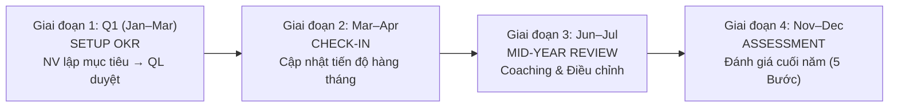

# 06 — Quản Trị Mục Tiêu & Đánh Giá Hiệu Suất OKR (OKR & Performance Appraisal)

> **Mục tiêu:** Mô tả chi tiết phân hệ OKR kết hợp Đánh giá thành tích cuối năm theo chuẩn biểu mẫu Ascend/ACT, cơ cấu 20% mục tiêu công ty + 80% cá nhân, Form đánh giá 4 Box, thang điểm 1–5 nguyên ở cấp độ nhóm, chu kỳ 5 phase cấu hình được, quy trình đánh giá 5 bước, bảng tổng hợp 9 trường và báo cáo điểm theo nhóm — **không Calibration/Bell Curve**.

---

## 1. Cơ Cấu Mục Tiêu & Triết Lý OKR Doanh Nghiệp

Mô hình OKR được thiết kế theo hướng thực tiễn cao, phản ánh chính xác form đánh giá quốc tế của tập đoàn:

> **Không có trọng số KR, không chấm theo hạng mục.** Mục tiêu cá nhân chia 2 nhóm
> **Business** và **People**, mỗi nhóm chấm **1 điểm 1–5** ở tầng nhóm. Phần 20% mục tiêu
> công ty là **tham khảo** (copy xuống nếu phù hợp), không tính vào điểm trung bình.

### 1.1. Company Objectives (20%) — Kế Thừa Tham Khảo
* Ban Điều hành công bố 5–6 mục tiêu chiến lược của năm (ví dụ: Tăng trưởng doanh thu, Phát triển sản phẩm mới, Tối ưu vận hành).
* Khi nhân viên tạo OKR, các mục tiêu này hiển thị dưới dạng **Thư viện gợi ý 1-chạm**: Nhân viên có thể bấm sao chép xuống bản OKR của mình nếu thấy phù hợp với vai trò của mình hoặc tự viết mục tiêu riêng.
* **Không vẽ cây phân tầng cồng kềnh (No complex cascading tree):** Nhân viên tập trung vào mục tiêu hành động cụ thể trực tiếp với Quản lý của mình.

### 1.2. Individual Objectives (80%) — Mục Tiêu Cá Nhân Tự Do
Được chia đều thành 2 nhóm nội dung lớn:
1. **Business Objectives:** Trọng tâm vào kết quả kinh doanh, dự án phần mềm, tiến độ release, giảm lỗi, tối ưu chi phí.
2. **People Objectives:** Trọng tâm vào phát triển con người, đào tạo nội bộ, xây dựng văn hóa đội ngũ, tư duy chiến lược.
* **Tính chất tự do:** Không giới hạn số lượng Key Results, không giới hạn độ dài ký tự, hỗ trợ đính kèm tệp tài liệu minh chứng (PDF, Word, Excel).

---

## 2. Biểu Mẫu Đánh Giá 4 Box (Form Structure — Screen S20, S21, S23)

Hệ thống số hóa 100% biểu mẫu đánh giá thực tế của công ty thành 4 khối chức năng:

```
┌────────────────────────────────────────────────────────────────────────┐
│ BOX 1: Thông Tin Cá Nhân & Vị Trí (Hệ thống tự điền tự động)           │
│ Họ tên · Mã NV · Vị trí · Band · Quản lý trực tiếp · Nhóm · Ngày vào  │
├────────────────────────────────────────────────────────────────────────┤
│ BOX 2: Business Objectives & Key Achievements                          │
│ • Danh sách mục tiêu công việc & kết quả then chốt đạt được           │
│ • Đính kèm file tài liệu / báo cáo chứng minh                         │
│ • ĐIỂM ĐÁNH GIÁ (Thang điểm 1 - 5, chỉ nhận số nguyên: 1, 2, 3, 4, 5)  │
├────────────────────────────────────────────────────────────────────────┤
│ BOX 3: People Objectives & Key Achievements                            │
│ • Danh sách mục tiêu phát triển con người & văn hóa                   │
│ • Đính kèm file tài liệu nếu có                                       │
│ • ĐIỂM ĐÁNH GIÁ (Thang điểm 1 - 5, chỉ nhận số nguyên: 1, 2, 3, 4, 5)  │
├────────────────────────────────────────────────────────────────────────┤
│ BOX 4: Self Proposal Next Year (Kế Hoạch & Điểm Cần Cải Thiện)         │
│ • Nhân viên tự đề xuất mục tiêu OKR định hướng cho năm tiếp theo       │
│ • Tự nhận định các điểm yếu và kỹ năng cần cải thiện                  │
└────────────────────────────────────────────────────────────────────────┘
                    ⬇ Hệ Thống Tự Động Tính Toán ⬇
       ĐIỂM TRUNG BÌNH OKR = (Điểm Box 2 + Điểm Box 3) ÷ 2
       KHÔNG XẾP LOẠI — chỉ hiển thị điểm 1–5 từng nhóm + điểm trung bình
```

### 3 Quy Tắc Chấm Điểm Khác Biệt
1. **Chấm ở tầng nhóm (Group-level Scoring):** Quản lý chấm **1 điểm duy nhất cho toàn bộ Box 2** và **1 điểm cho toàn bộ Box 3** để đánh giá tổng thể thành tựu, không bắt bẻ chấm lẻ từng gạch đầu dòng.
2. **Thang điểm nguyên tuyệt đối (Integer 1 to 5):** Chỉ chấp nhận điểm số `1, 2, 3, 4, 5`. Hệ thống từ chối các điểm lẻ như `2.5` hay `3.7`.
3. **Điểm trung bình tự động (No manual average):** Máy tính tự động tính trung bình cộng, không cho phép gõ tay để chống sai lệch công thức.

---

## 3. Chu Kỳ OKR 5 Phase & Quy Trình Đánh Giá 5 Bước



### Quy Trình Đánh Giá Cuối Năm (5 Bước Chi Tiết)

| Bước | Người thực hiện | Nhiệm vụ nghiệp vụ | Thời hạn (SLA) |
|---|---|---|---|
| **Bước 1** | **Nhân viên** | Tự điền thành tích Box 2, Box 3, Box 4; tự chấm điểm bản thân (1–5). Bấm Nộp. | 3–5 ngày làm việc (Khóa link khi hết hạn) |
| **Bước 2** | **Quản lý trực tiếp** | Xem xét thành tích, mở file đính kèm, chấm điểm chính thức (1–5 cho từng Box). | 5 ngày làm việc (Khóa link khi hết hạn) |
| **Bước 3** | **HR Admin** | Thu thập toàn bộ đánh giá từ các nhóm, tổng hợp vào Báo cáo Master 9 trường. | Theo lịch công ty |
| **Bước 4** | **Ban Lãnh đạo / Giám đốc** | Giám đốc phần mềm & Giám đốc CNTT vùng đánh giá chung, thống nhất điểm các nhóm (không cân chuẩn/xếp loại). | Theo lịch công ty |
| **Bước 5** | **HR Admin** | Khóa kết quả chính thức, công bố **điểm 1–5** và xuất file Excel cho Hội đồng Lương thưởng. | Hoàn tất chu kỳ |

---

## 4. Báo Cáo Tổng Hợp OKR Chuẩn HR (9 Trường Bắt Buộc — Screen S25)

Hệ thống tự động sinh báo cáo tổng hợp Master gồm 9 trường chuẩn nghiệp vụ:
1. `Họ và Tên`: Full Name
2. `Mã nhân viên`: Employee Code
3. `Vị trí / Chức danh`: Job Title
4. `Thời gian công tác`: **Tự động tính bằng tháng/năm** căn cứ từ `joined_date` đến ngày 31/12 của năm đánh giá.
5. `Nhóm`: Team (không có phòng ban)
6. `Tên Quản lý trực tiếp`: Line Manager Name
7. `Điểm OKR công việc`: Điểm Box 2 (Business Score: 1–5)
8. `Điểm OKR con người`: Điểm Box 3 (People Score: 1–5)
9. `Điểm trung bình & Ghi chú`: Average Score + ghi chú (không xếp loại A/B/C/D).

---

## 5. Báo cáo điểm theo nhóm (Screen S25)

* Giám đốc & HR xem **bảng điểm 1–5 theo nhóm** và điểm trung bình — **không xếp loại A/B/C/D**.
* Không có Bell Curve/Calibration Board: lãnh đạo đánh giá trực tiếp vào bảng tổng hợp,
  mọi điều chỉnh điểm đều có lý do + audit log.
* Hệ thống chỉ lưu **điểm**, không sinh thêm hạng/xếp loại.
