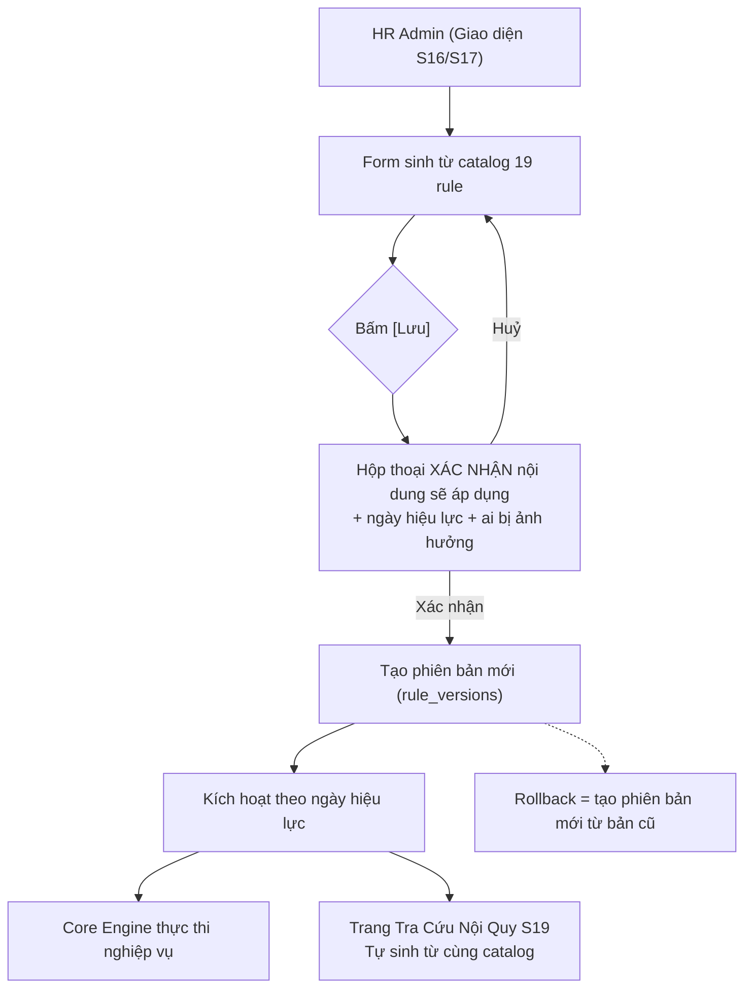

# 07 — Hệ Thống Cấu Hình Quy Định Động (Dynamic Rule Engine)

> **Mục tiêu:** Mô tả chi tiết trái tim công nghệ của hệ thống — Bộ máy cấu hình quy định (Rule Engine) quản lý toàn bộ 19 quy định nghiệp vụ thông qua dữ liệu (Data-driven Configuration), cơ chế Quản lý phiên bản (Versioning), Hoàn tác (Rollback), Chạy thử nghiệm (xác nhận khi lưu) và Trang tra cứu nội quy tự động (Screen S19).

---

## 1. Kiến Trúc Rule Engine & Nguyên Tắc Vận Hành

Trong hầu hết các phần mềm HR truyền thống, khi ban giám đốc đổi quy định (ví dụ: tăng quota đi muộn từ 2 lên 3 lần, đổi giờ làm từ 8h00 sang 8h30), phòng HR phải gửi yêu cầu sang đội IT để sửa code, test và deploy lại.

**Giải pháp của ACT HR 2026:**
* **100% Logic quy định được tham số hóa thành Dữ liệu (Configuration as Data).**
* Toàn bộ tham số được lưu trong bảng `rules` và `rule_versions`.
* Backend Engine chỉ đọc các tham số đang có hiệu lực (`is_active = true` và `NOW() >= effective_from`) để thực thi logic.

> **Không có dry-run / màn S18.** Business chốt: khi lưu hiện **hộp thoại xác nhận**;
> lịch sử phiên bản + rollback nằm ngay trong màn cấu hình S17.

---

## 2. Danh Mục 19 Quy Định Cấu Hình Động (Rule Catalog)

> **Nguồn sự thật:** `docs/06-business-rule-builder.md` §3.1. Mỗi rule có `rule_id` (snake_case),
> một bộ **field** (kiểu, mặc định, khoảng giá trị, mô tả) và được lưu trong `rules.current_value`
> dưới dạng **JSON object**. Tổng cộng **124 field**. Hệ thống đọc rule qua `RuleService` — **không hard-code**.
>
> **Tự duyệt đơn (`approval_flow`):** `RequestController.decide()` cho phép người gửi tự duyệt khi
> `allow_self_approval`=true, vai trò ≥ `self_approval_min_role`, và `self_approval_scope`=ALWAYS
> (hoặc NO_MANAGER + không có quản lý trực tiếp hợp lệ). `GET /requests/inbox` trả thêm cờ
> `selfRequest`; HR luôn thấy mọi đơn đang chờ.

| # | `rule_id` | Tên | Nhóm | Field chính (mặc định) |
|---|---|---|---|---|
| 1 | `late_early` | Đi muộn / về sớm | Đơn từ | `max_count`=2 · `max_minutes`=60 · `submit_within_days`=3 · `allow_late_request`=true |
| 2 | `makeup` | Bổ sung chấm công | Đơn từ | `max_count`=5 · `deadline_working_days`=3 · `allow_overdue_with_approval`=false |
| 3 | `wfh` | Làm việc từ xa | Đơn từ | `max_count`=2/tuần · `min_duration_days`=0.5 · `block_third_day`=true |
| 4 | `hr_approval` | Nhóm có bước HR duyệt thêm | Đơn từ | `teams`=["CA","Mobile"] · chỉ `LATE_EARLY/ADJUST/WFH` — **nghỉ phép không chuyển HR** |
| 5 | `approval_flow` | Luồng duyệt đơn | Đơn từ | 1 bước quản lý trực tiếp · `sla_hours`=48 · `allow_withdraw`=true · `allow_self_approval`=true · `self_approval_min_role`=MANAGER · `self_approval_scope`=ALWAYS |
| 6 | `attendance_security` | Kiểm tra khi chấm công | Chấm công | `require_internal_network`=Bật · `geofence_radius_m`=150 · `gps_accuracy_tolerance_m`=100 · `allow_offline_punch`=Bật · `offline_max_hours`=24 · `max_devices`=**2** · `require_face_verification`=Bật · `face_match_threshold`=**85** · `require_liveness`=Bật · `face_max_attempts`=3 · `grace_minutes`=0 |
| 7 | `share_account` | Chống dùng chung tài khoản | Chấm công | `max_checkin_per_day`=1 · `require_password_change`=Bật · `device_confirm_required`=Bật · `max_additional_devices`=1 · `device_expiry_days`=90 |
| 8 | `shift_times` | Giờ làm việc | Chấm công | khung 08:00–09:30 / 17:00–18:30 · nghỉ trưa 12:00–13:00 · `required_work_hours`=8 · `is_flexible`=false · khung linh hoạt 08–10 / 17–19 |
| 9 | `shift` | Ca & bộ gán ca | Chấm công | ca mặc định 08:30–17:30 · ca ngoại lệ theo nhóm/chức vụ |
| 10 | `late_without_request` | Đi muộn không có đơn | Bảng công | `deduct_actual_minutes`=true · `count_as_absent`=false |
| 11 | `payroll_period` | Kỳ công & khiếu nại | Bảng công | `publish_day`=**11** · `dispute_window_days`=2 · `lock_delay_days`=3 · `allow_adjust_after_lock`=false |
| 12 | `leave_type_defaults` | Mặc định chung cho loại nghỉ | Nghỉ phép | `submit_within_days`=3 · `require_attachment`=false · `allow_negative_balance`=false |
| 13 | `leave_request` | Thời hạn & điều kiện xin nghỉ | Nghỉ phép | `submit_within_days`=3 (theo ngày, không theo giờ) |
| 14 | `leave_accrual` | Cách cộng phép | Nghỉ phép | `base_days_per_year`=12 · `accrual_on`=15 · `probation_days`=2 · `advance_max_days`=3 |
| 15 | `leave_seniority` | Phép thâm niên | Nghỉ phép | `interval_years`=2 · `days_per_interval`=1 · cộng đúng ngày tròn |
| 16 | `leave_position_bonus` | Phép theo chức vụ | Nghỉ phép | `manager_bonus_days`=3 |
| 17 | `leave_carryover` | Phép tồn | Nghỉ phép | giữ toàn bộ trước 01/04 · tối đa 5 ngày 01/04–01/07 · từ 01/07 = 0 |
| 18 | `okr_evaluation` | Cách đánh giá | OKR | `scale_min`=1 · `scale_max`=5 · `score_categories`=2 · `checkin_interval`=MONTHLY · **không xếp loại A/B/C/D** |
| 19 | `notification` | Chính sách nhắc việc | Dùng chung | `max_push_per_day`=3 · quiet hours 21:00–07:00 · `dedupe_window_hours`=12 · `escalate_after_days`=3 |

### 3.1. Cơ Chế Quản Lý Phiên Bản & Ngày Hiệu Lực
* Mỗi khi HR lưu chỉnh sửa quy định tại `S16/S17`:
  * Hệ thống **không ghi đè trực tiếp** lên bản ghi hiện tại.
  * Tự động tạo một dòng mới trong bảng `rule_versions` với số phiên bản tăng dần (`v1.0`, `v1.1`, `v2.0`).
  * HR bắt buộc chọn trường `effective_from` (Ngày bắt đầu áp dụng) và nhập `change_reason` (Lý do thay đổi).
  * Lịch sử được lưu trữ vĩnh viễn phục vụ thanh tra lao động.

### 3.2. Xác Nhận Khi Lưu (thay cho dry-run)

Business **đã bỏ màn S18/dry-run**. Thay vào đó, khi HR bấm **Lưu** tại S17:
* Hệ thống hiện **hộp thoại xác nhận** gồm: tên quy định · giá trị mới · **ngày hiệu lực** ·
  lý do thay đổi · cảnh báo nếu giá trị nằm ngoài khoảng cho phép.
* HR xác nhận → backend tạo **phiên bản mới** trong `rule_versions` và cập nhật `rules.current_value`.
* Không có bước "chạy thử trên dữ liệu tháng trước".

### 3.3. Cơ Chế Hoàn Tác 1-Chạm (Rollback)
Nếu quy định mới ban hành gặp phản ứng tiêu cực hoặc phát sinh lỗi vận hành:
* HR vào **Lịch sử phiên bản** (ngay trong S17), bấm **[Rollback về v1.0]**.
* Hệ thống kích hoạt lại tham số cũ trong 1 giây mà không cần can thiệp kỹ thuật.

---

## 4. Trang Tra Cứu Nội Quy Tự Động Cho Nhân Viên (Screen S19)

* **Loại bỏ tình trạng "Nội quy một đằng, Phần mềm chạy một nẻo":**
  * Trang `S19 - Tra cứu quy định` dành cho nhân viên không phải là trang văn bản tĩnh do HR gõ tay.
  * Nội dung được **tự động biên dịch (Auto-generated)** từ chính các tham số đang active trong Rule Engine thành văn bản tiếng Việt/Anh chuẩn mực.
  * *Ví dụ:* Khi HR đổi `late_early.max_count` thành `3`, trang quy định của nhân viên lập tức hiển thị: *"Theo quy định hiện hành, mỗi nhân viên được phép đi muộn/về sớm tối đa 3 lần/tháng"*.
* Nhân viên có thể tìm kiếm nhanh câu hỏi thường gặp (FAQ) qua thanh tìm kiếm toàn cục `Ctrl+K`.
