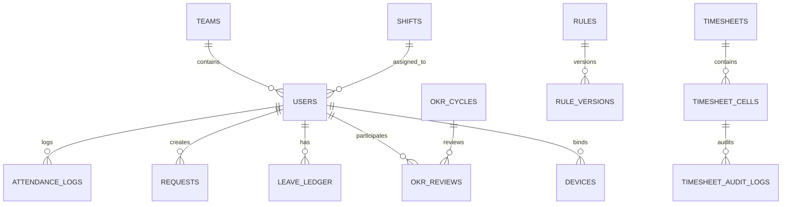

# 09 — Đặc Tả API Endpoints & Cấu Trúc Cơ Sở Dữ Liệu (API Spec & DB Schema)

> **Mục tiêu:** Cung cấp tài liệu kỹ thuật chi tiết về cơ sở dữ liệu quan hệ (PostgreSQL) và danh mục các RESTful API Endpoints phục vụ toàn bộ các màn hình và phân hệ trong hệ thống.

---

## 1. Cấu Trúc Cơ Sở Dữ Liệu Vật Lý (Database Physical Schema)

### 1.1. Bảng Người Dùng & Phân Quyền (`users`, `teams`, `shifts`, `devices`)
* **`users`**:
  * `id`: UUID PRIMARY KEY
  * `employee_code`: VARCHAR(30) UNIQUE NOT NULL
  * `full_name`: VARCHAR(150) NOT NULL
  * `email`: VARCHAR(150) UNIQUE NOT NULL
  * `password_hash`: VARCHAR(255) NOT NULL
  * `role`: VARCHAR(30) NOT NULL (`EMPLOYEE`, `MANAGER`, `HR_ADMIN`, `ADMIN`)
  * `team_id`: UUID REFERENCES `teams(id)`
  * `team_id`: UUID REFERENCES `teams(id)`
  * `manager_id`: UUID REFERENCES `users(id)`
  * `shift_id`: UUID REFERENCES `shifts(id)`
  * `joined_date`: DATE NOT NULL
  * `status`: VARCHAR(30) DEFAULT 'PENDING_ACTIVATION'
  * `must_change_password`: BOOLEAN DEFAULT TRUE
  * `face_enrolled`: BOOLEAN DEFAULT FALSE
  * `face_embedding`: vector(512) -- pgvector
  * `created_at`, `updated_at`: TIMESTAMP WITH TIME ZONE
* **`devices`**:
  * `id`: UUID PRIMARY KEY
  * `user_id`: UUID REFERENCES `users(id)`
  * `device_fingerprint`: VARCHAR(255) UNIQUE NOT NULL
  * `device_model`: VARCHAR(100)
  * `os_version`: VARCHAR(50)
  * `is_approved`: BOOLEAN DEFAULT TRUE
  * `last_active_at`: TIMESTAMP WITH TIME ZONE

### 1.2. Bảng Chấm Công (`attendance_logs`)
* **`attendance_logs`**:
  * `id`: UUID PRIMARY KEY
  * `user_id`: UUID REFERENCES `users(id)`
  * `shift_id`: UUID REFERENCES `shifts(id)`
  * `type`: VARCHAR(20) NOT NULL (`CHECK_IN`, `CHECK_OUT`)
  * `server_timestamp`: TIMESTAMP WITH TIME ZONE NOT NULL DEFAULT NOW()
  * `client_timestamp`: TIMESTAMP WITH TIME ZONE
  * `is_offline_sync`: BOOLEAN DEFAULT FALSE
  * `wifi_ssid`: VARCHAR(100)
  * `wifi_bssid`: VARCHAR(100)
  * `latitude`: DECIMAL(10, 8)
  * `longitude`: DECIMAL(11, 8)
  * `distance_meters`: DECIMAL(10, 2)
  * `liveness_score`: DECIMAL(5, 4)
  * `face_match_distance`: DECIMAL(5, 4)
  * `status`: VARCHAR(30) NOT NULL (`VALID`, `REJECTED`) — không có cờ 'vẫn tính công'
  * `snapshot_url`: VARCHAR(255)

### 1.3. Bảng Đơn Từ (`requests`)
* **`requests`**:
  * `id`: UUID PRIMARY KEY
  * `request_code`: VARCHAR(50) UNIQUE NOT NULL (ví dụ: `REQ-2026-00124`)
  * `user_id`: UUID REFERENCES `users(id)`
  * `type`: VARCHAR(30) NOT NULL (`LATE_EARLY`, `ATTENDANCE_ADJUST`, `LEAVE`, `WFH`)
  * `leave_type`: VARCHAR(20) (`AL`, `S`, `NL`, `RO`, `CL`, `ML`, `PL`, `UP`)
  * `status`: VARCHAR(30) NOT NULL (`DRAFT`, `PENDING_APPROVAL`, `APPROVED`, `REJECTED`, `WITHDRAWN`)
  * `start_date`: DATE NOT NULL
  * `end_date`: DATE NOT NULL
  * `duration_days`: DECIMAL(4, 2)
  * `minutes`: INTEGER (dùng cho đơn đi muộn/về sớm)
  * `target_checkin_time`: TIMESTAMP WITH TIME ZONE (dùng cho đơn bổ sung công)
  * `reason`: TEXT NOT NULL
  * `attachment_url`: VARCHAR(255) (giấy khám bệnh cho đơn ốm)
  * `current_approver_id`: UUID REFERENCES `users(id)`
  * `rejection_reason`: TEXT
  * `submitted_at`: TIMESTAMP WITH TIME ZONE
  * `approved_at`: TIMESTAMP WITH TIME ZONE

### 1.4. Bảng Sổ Phép (`leave_balances`, `leave_ledger`)
* **`leave_balances`**:
  * `user_id`: UUID PRIMARY KEY REFERENCES `users(id)`
  * `year`: INTEGER NOT NULL
  * `base_days`: DECIMAL(4, 2) DEFAULT 0
  * `role_bonus_days`: DECIMAL(4, 2) DEFAULT 0
  * `seniority_days`: DECIMAL(4, 2) DEFAULT 0
  * `carried_over_days`: DECIMAL(4, 2) DEFAULT 0
  * `used_days`: DECIMAL(4, 2) DEFAULT 0
  * `advanced_days`: DECIMAL(4, 2) DEFAULT 0
  * `available_days`: DECIMAL(4, 2) GENERATED ALWAYS AS (base_days + role_bonus_days + seniority_days + carried_over_days - used_days) STORED
* **`leave_ledger`**:
  * `id`: UUID PRIMARY KEY
  * `user_id`: UUID REFERENCES `users(id)`
  * `action`: VARCHAR(50) (`MONTHLY_ACCRUAL`, `ROLE_BONUS`, `SENIORITY_ADD`, `LEAVE_CONSUMED`, `CARRYOVER_EXPIRED`, `MANUAL_ADJUST`)
  * `amount`: DECIMAL(4, 2) NOT NULL
  * `balance_after`: DECIMAL(4, 2) NOT NULL
  * `reference_request_id`: UUID REFERENCES `requests(id)`
  * `created_at`: TIMESTAMP WITH TIME ZONE DEFAULT NOW()

### 1.5. Bảng Chấm Công 53 cột (`timesheets`, `timesheet_cells`, `timesheet_audit_logs`)
* **`timesheets`**:
  * `id`: UUID PRIMARY KEY
  * `period_month`: INTEGER NOT NULL
  * `period_year`: INTEGER NOT NULL
  * `status`: VARCHAR(20) DEFAULT 'draft' (`draft`, `published`, `reviewing`, `locked`)
  * `published_at`, `dispute_deadline`, `locked_at`: TIMESTAMP WITH TIME ZONE
  * `locked_by`: UUID REFERENCES `users(id)`
* **`timesheet_cells`**:
  * `id`: UUID PRIMARY KEY
  * `timesheet_id`: UUID REFERENCES `timesheets(id)`
  * `user_id`: UUID REFERENCES `users(id)`
  * `work_date`: DATE NOT NULL
  * `symbol`: VARCHAR(20) (`1.00`, `0.50`, `R`, `AL`, `S`...)
  * `work_minutes`: INTEGER DEFAULT 0
  * `is_manual`: BOOLEAN DEFAULT FALSE
* **`timesheet_audit_logs`**:
  * `id`: UUID PRIMARY KEY
  * `timesheet_cell_id`: UUID REFERENCES `timesheet_cells(id)`
  * `old_value`: VARCHAR(20)
  * `new_value`: VARCHAR(20)
  * `reason`: TEXT NOT NULL
  * `changed_by`: UUID REFERENCES `users(id)`
  * `created_at`: TIMESTAMP WITH TIME ZONE DEFAULT NOW()

### 1.6. Bảng OKR (`okr_cycles`, `okr_reviews`, `okr_items`)
* **`okr_cycles`**:
  * `id`: UUID PRIMARY KEY
  * `year`: INTEGER NOT NULL
  * `current_phase`: VARCHAR(30) (`SETUP`, `CHECK_IN`, `MID_YEAR_REVIEW`, `ASSESSMENT`, `CLOSED`)
* **`okr_reviews`**:
  * `id`: UUID PRIMARY KEY
  * `cycle_id`: UUID REFERENCES `okr_cycles(id)`
  * `user_id`: UUID REFERENCES `users(id)`
  * `box1_snapshot`: JSONB (Họ tên, Vị trí, Band, Team, Quản lý)
  * `box2_business_text`: TEXT
  * `box2_attachment_url`: VARCHAR(255)
  * `box2_self_score`: INTEGER (1-5)
  * `box2_manager_score`: INTEGER (1-5)
  * `box3_people_text`: TEXT
  * `box3_attachment_url`: VARCHAR(255)
  * `box3_self_score`: INTEGER (1-5)
  * `box3_manager_score`: INTEGER (1-5)
  * `box4_proposal_next_year`: TEXT
  * `final_average_score`: DECIMAL(3, 2)
  * `current_step`: INTEGER DEFAULT 1 (1 đến 5)
  * `status`: VARCHAR(30) DEFAULT 'DRAFT'

### 1.7. Bảng Rule Engine (`rules`, `rule_versions`)
* **`rules`**:
  * `id`: UUID PRIMARY KEY
  * `rule_key`: VARCHAR(100) UNIQUE NOT NULL
  * `name`: VARCHAR(200) NOT NULL
  * `category`: VARCHAR(50) NOT NULL (`REQUESTS`, `ATTENDANCE`, `LEAVE`, `OKR`, `NOTIFICATIONS`)
  * `data_type`: VARCHAR(30) NOT NULL (`INTEGER`, `DECIMAL`, `STRING`, `BOOLEAN`, `JSON`)
  * `current_value`: TEXT NOT NULL
* **`rule_versions`**:
  * `id`: UUID PRIMARY KEY
  * `rule_id`: UUID REFERENCES `rules(id)`
  * `version`: VARCHAR(20) NOT NULL
  * `value`: TEXT NOT NULL
  * `effective_from`: TIMESTAMP WITH TIME ZONE NOT NULL
  * `change_reason`: TEXT NOT NULL
  * `created_by`: UUID REFERENCES `users(id)`
  * `created_at`: TIMESTAMP WITH TIME ZONE DEFAULT NOW()

---

## 2. Đặc Tả RESTful API Endpoints

### 2.1. Phân Hệ Xác Thực & Tài Khoản (Authentication & Users)
* `POST /api/v1/auth/login`
  * Body: `{ "employee_code_or_email": "136ACT", "password": "..." }`
  * Response: `{ "access_token": "...", "must_change_password": true, "face_enrolled": false }`
* `POST /api/v1/auth/change-password`
  * Headers: `Authorization: Bearer <token>`
  * Body: `{ "current_password": "...", "new_password": "..." }`
* `POST /api/v1/auth/face-enroll`
  * Body: `{ "face_embedding": [0.12, -0.45, ...], "snapshot_image": "base64/binary" }`
* `POST /api/v1/admin/users` (HR tạo nhân viên & tự động gửi Gmail kích hoạt)
  * Body: `{ "employee_code": "151ACT", "full_name": "...", "email": "...", "team_id": "...", "manager_id": "...", "joined_date": "2026-11-01" }`
* `POST /api/v1/admin/users/import-excel` (Import danh sách hàng loạt)
* `POST /api/v1/admin/users/{id}/reset-password` (HR reset mật khẩu & bắn email)

### 2.2. Phân Hệ Chấm Công (Attendance)
* `POST /api/v1/attendance/check-in`
  * Body: `{ "face_embedding": [...], "wifi_ssid": "ACT_Office_5G", "wifi_bssid": "...", "latitude": 21.0285, "longitude": 105.8542, "is_offline": false, "snapshot_image": "base64" }`
  * Response: `{ "status": "VALID", "server_timestamp": "2026-11-18T08:15:22+07:00", "message": "Check-in thành công" }`
* `POST /api/v1/attendance/check-out`
* `GET /api/v1/attendance/today-status` (Lấy trạng thái chấm công hôm nay cho S05m)
* `GET /api/v1/attendance/monthly-calendar?month=11&year=2026` (Dữ liệu lịch công S06)

### 2.3. Phân Hệ Đơn Từ & Phê Duyệt (Requests & Approval)
* `POST /api/v1/requests` (Tạo đơn - Lưu nháp hoặc Gửi duyệt)
  * Body: `{ "type": "LEAVE", "leave_type": "AL", "start_date": "2026-11-20", "end_date": "2026-11-21", "reason": "...", "is_draft": false }`
* `GET /api/v1/requests/my-requests` (Danh sách đơn của tôi S08)
* `GET /api/v1/requests/inbox` (Hộp thư duyệt của quản lý S12 - kèm filter chip điều kiện)
* `POST /api/v1/requests/{id}/approve` (Duyệt đơn lẻ)
* `POST /api/v1/requests/bulk-approve` (Duyệt hàng loạt: `{ "request_ids": ["uuid1", "uuid2"] }`)
* `POST /api/v1/requests/{id}/reject` (Bắt buộc kèm `{ "reason": "..." }`)
* `POST /api/v1/requests/{id}/withdraw` (Rút đơn khi chưa duyệt)

### 2.4. Phân Hệ Bảng Công & Sổ Phép (Timesheet & Leaves)
* `GET /api/v1/timesheets/monthly?month=10&year=2026` (Lưới bảng công 53 cột S15)
* `PUT /api/v1/timesheets/cells/{id}` (Sửa ô tại chỗ kèm audit reason)
  * Body: `{ "new_value": "1.00", "reason": "Bổ sung theo giải trình quản lý" }`
* `POST /api/v1/timesheets/{id}/lock` (HR khóa bảng công)
* `GET /api/v1/timesheets/export-excel?month=10&year=2026` (Tải file Excel chuẩn)
* `GET /api/v1/leaves/my-balance` (Xem số dư phép & cảnh báo hạn phép tồn S09)
* `GET /api/v1/leaves/ledger/{user_id}` (Xem sổ cái biến động phép S34)

### 2.5. Phân Hệ OKR (Performance Appraisal)
* `GET /api/v1/okr/my-review?cycle_year=2026` (Xem form OKR 4 Box cá nhân)
* `PUT /api/v1/okr/my-review/self-assessment` (Nhân viên tự chấm & nộp Bước 1)
* `PUT /api/v1/okr/reviews/{id}/manager-assessment` (Quản lý chấm 1-5 Bước 2)
* `GET /api/v1/okr/team-review` (Bảng so sánh review cả nhóm & điểm S24)
* `GET /api/v1/okr/summary-report?year=2026` (Bảng tổng hợp 9 trường chuẩn HR S25)
* `GET /api/v1/okr/summary-report/export-excel` (Xuất file Excel tổng hợp OKR)

### 2.6. Phân Hệ Rule Engine (Configuration)
* `GET /api/v1/rules` (Danh sách 19 quy định S16)
* `PUT /api/v1/rules/{rule_key}` (Cập nhật quy định mới có versioning & effective date)
* `POST /api/v1/rules/{rule_key}/rollback` (Hoàn tác về phiên bản cũ)
* `GET /api/v1/rules/public-policy-doc` (Sinh nội dung Markdown trang tra cứu nội quy S19)

### 2.7. Phân Hệ Hộp Thư Todo & Tiện Ích (Todo & Command Palette)
* `GET /api/v1/todos/my-inbox` (Lấy danh sách việc cần làm phân theo 3 mức ưu tiên S02)
* `GET /api/v1/search/command-palette?q=Vinh` (Tìm kiếm tức thì Ctrl+K S03)
* `GET /api/v1/notifications/unread-count` (Lấy số đỏ badge thông báo)

---

## 3. Bảng Còn Thiếu Trong DDL — Bổ Sung Theo Business

> Các bảng dưới đây có trong nghiệp vụ (docs/05) và đã được thêm ở migration `V2__align_with_business.sql`.

| Bảng | Mục đích |
|---|---|
| `face_profiles` | Hồ sơ khuôn mặt (vector 512D, **không lưu ảnh thô**) |
| `attendance_logs` | 1 dòng/người/ngày: `check_in_at`, `check_out_at`, unique `(user_id, work_date)` |
| `refresh_tokens` | Phiên làm mới (lưu mã băm) để **thu hồi** khi đổi mật khẩu/đăng xuất |
| `login_attempts` | Đếm lần đăng nhập sai → khoá 10′ / khoá vĩnh viễn |
| `timesheets` · `timesheet_cells` · `timesheet_audit_logs` | Bảng công 53 cột + audit sửa ô |
| `okr_cycles` · `okr_reviews` · `okr_items` | Chu kỳ 5 phase, review/đánh giá, đầu việc 2 nhóm |
| `requests` | 4 loại đơn + `applied_parameters` (snapshot tham số lúc gửi) |
| `leave_ledger` | Sổ phép append-only |
| `teams.parent_id` | Nhóm lồng nhau, số tầng tự do (đã thêm cột) |
| `users.activated_at` | Thời điểm kích hoạt tài khoản |

> Đã gỡ `departments` (business không có phòng ban) và `delegations` (đã bỏ ủy quyền).

## 4. Endpoint Còn Thiếu — Bổ Sung Theo Màn Hình Business

| Màn | Endpoint |
|---|---|
| S01 | `POST /api/v1/auth/refresh` · `POST /api/v1/auth/logout` · `GET /api/v1/auth/me` |
| S11 | `GET /api/v1/attendance/my-timesheet` |
| S13 | `GET /api/v1/requests/{id}` |
| S14 | `GET /api/v1/attendance/team-schedule` |
| S20 | `GET /api/v1/okr/dashboard` |
| S21 | `POST /api/v1/okr/objectives` |
| S22 | `POST /api/v1/okr/check-ins` |
| S23 | `PUT /api/v1/okr/reviews/{id}/self-assessment` |
| S24 | `GET /api/v1/okr/team-review` |
| S26 | `GET /api/v1/admin/shifts` |
| S27 | `GET /api/v1/devices` |
| S28 | `GET /api/v1/admin/devices` |
| S29 | `POST /api/v1/devices/request` |
| S30 | `GET /api/v1/leave-types` |
| S32 | `GET /api/v1/admin/leave-types` |
| S33 | `GET /api/v1/disputes/{id}` |
| S35 | `GET /api/v1/audit-logs` |
| S36 | `GET /api/v1/notifications/preferences` |
| S40 | `GET /api/v1/admin/users` |
| S41 | `GET /api/v1/admin/org-tree` |
| S42 | `POST /api/v1/okr/objectives/{id}/approve` |
| S43 | `GET /api/v1/okr/mid-year-reviews` |
| S44 | `GET /api/v1/okr/cycles` |
| S45 | `GET /api/v1/disputes` |
| S46 | `GET /api/v1/leaves/table` |

> `PUT /api/v1/rules/{ruleKey}` + `GET /api/v1/rules/{ruleKey}/versions` + rollback đã thay cho `/rules/dry-run`.

---

## Cập nhật API & schema thực tế — 20/11/2026

### Schema
* `requests`: `work_date`, **`end_date`**, `payload JSONB`, `applied_parameters JSONB`, `minutes`, `status`, `decided_by/at`, `decision_comment`. (Không dùng `request_code/start_date/target_checkin_time`.)
* `request_attachments`: `id, request_id, file_name, content_type, size_bytes, data BYTEA, uploaded_by, created_at`.
* `timesheet_disputes`, `todo_completions` (V9/V10); `timesheets`, `timesheet_cells`, `timesheet_audit_logs` đang được dùng thật.
* `leave_types` thêm `submit_within_days`, `requires_attachment`, `unit`, `is_paid`, `deducts_annual_leave`, `config`.

### Endpoints đơn từ
| Method | Endpoint | Ghi chú |
|---|---|---|
| POST | `/requests` | body `{type, leaveType, workDate, endDate, minutes, reason, payload, draft, replaceConflicts, excludeId}` |
| POST | `/requests/check-conflicts` | Trả danh sách đơn LEAVE/WFH trùng ngày+buổi (PENDING/APPROVED), có `excludeId` khi sửa |
| GET | `/requests/my-requests?page&size&from&to&type&status&keyword` | Trả `content/page/size/totalElements/totalPages`; không truyền `page` → list cũ |
| PUT | `/requests/{id}` | Sửa đơn của mình khi DRAFT/PENDING/REJECTED → PENDING, xoá quyết định cũ |
| POST | `/requests/{id}/submit` | Gửi duyệt đơn nháp |
| POST | `/requests/{id}/attachments` | multipart `file`, nhiều lần cho nhiều file;ảnh/PDF ≤10MB |
| GET | `/requests/{id}/attachments` | Danh sách file (chủ đơn/quản lý/HR) |
| GET | `/requests/{id}/attachments/{attachmentId}` | Tải file thật |
| GET | `/requests/{id}` | Chi tiết + timeline + `endDate`, `leaveTypeName`, `approverName`, `attachmentCount` |
| GET | `/requests/inbox` | Kèm `employeeCode/Name`, `endDate`, `leaveTypeName`, `attachmentCount` |
| POST | `/requests/{id}/approve` | Chặn nếu loại nghỉ cần giấy tờ mà chưa có file |
| POST | `/requests/{id}/reject` | Bắt buộc lý do |

### Endpoints bảng công / khiếu nại
* `GET /timesheets?month=YYYY-MM` — 53 cột, đọc DB (log + đơn duyệt + ngày lễ + ô sửa DB), trả `status` từ `timesheets`.
* `POST /timesheets/cell`, `/timesheets/bulk` — ghi `timesheet_cells` + `timesheet_audit_logs`; bắt buộc lý do; chặn khi khoá.
* `POST /timesheets/publish`, `/timesheets/lock` — lưu `timesheets`; lock đếm pending từ `timesheet_disputes`.
* `POST /disputes` (nhân viên tạo), `GET /disputes`, `GET /disputes/{id}`, `POST /disputes/{id}/resolve` — DB `timesheet_disputes`.
* `GET /attendance/my-shift` — ca thật (khung vào/ra, nghỉ trưa, giờ/ngày) để tính đi muộn/về sớm và hiển thị giờ làm.

### Cron phép
* `POST /cron/monthly-leave-accrual` — cộng phép tháng (đọc `leave_accrual.accrual_on`/`base_days_per_year`, ACTIVE, idempotent, backfill `backfilledMonths`).
* `POST /cron/leave-carry-expiry` — cắt phép tồn theo `leave_carryover`, ghi `EXPIRED` + audit, idempotent.
* `POST /cron/yearly-seniority-accrual` — cộng thâm niên đúng ngày tròn, đọc `days_per_interval`.
