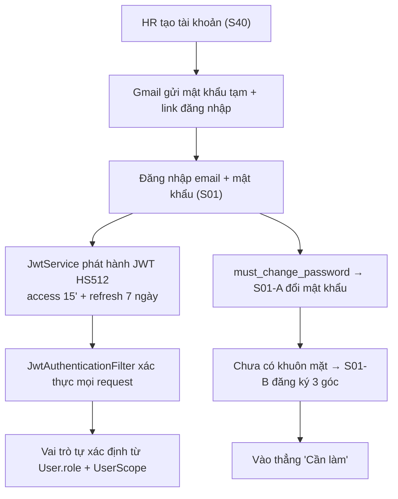

# 11 — Cấu Trúc Dự Án, Phân Rã Module & Quy Ước Tổ Chức Mã Nguồn (Project Structure & Code Conventions)

> **Mục tiêu:** Cung cấp tài liệu cẩm nang kỹ thuật chi tiết về cấu trúc mã nguồn toàn bộ dự án (`hkt/`), ý nghĩa của từng thư mục, module, luồng kiến trúc (Architectural Flow), cách thức tổ chức mã nguồn và mô hình **xác thực tài khoản nội bộ (Non-SSO)** kết hợp quản lý tổ chức/nhân sự trên ứng dụng.

---

## 1. Triết Lý Kiến Trúc & Cây Thư Mục Tổng Thể (`hkt/`)

Dự án được quy hoạch theo mô hình **Modular Monorepo** với tất cả mã nguồn nằm trong thư mục gốc `hkt/`:

```
hkt/
├── backend/
│   ├── core-service/               # ☕ Java Spring Boot 3 (ACT PULSE Core)
│   └── ai-face-service/            # 🐍 Python FastAPI (AI Face Recognition & Liveness)
│
├── frontend/                       # ⚡ Vite + React 18 + TypeScript + TailwindCSS
│
└── deploy/                         # 🚀 Hạ tầng triển khai container hóa
    ├── docker/                     # Docker Compose (Môi trường phát triển Local All-in-One)
    └── k8s/base/                   # Kubernetes Manifests & Ingress (Sẵn sàng Production)
```

---

## 2. Xác Thực Tài Khoản Nội Bộ (Non-SSO)

Hệ thống **không dùng Keycloak/Google SSO**. Luồng xác thực:



* **Mật khẩu:** bcrypt cost 12; policy ≥ 8 ký tự, hoa + thường + số + ký tự đặc biệt.
* **Khoá đăng nhập:** sai 5 lần → khoá 10 phút; sai 10 lần → khoá vĩnh viễn (HR mở).
* **Phiên:** bảng `refresh_tokens` lưu **mã băm**; đổi mật khẩu/đăng xuất → thu hồi toàn bộ phiên.
* **Phân quyền:** `@EnableMethodSecurity` + `JwtAuthenticationFilter`; mọi endpoint (trừ login/refresh) yêu cầu token.
* **Không có** `KeycloakAdminConfig` / `KeycloakSyncService` — các class này chỉ từng có trong tài liệu cũ.

## 3. Chi Tiết Cấu Trúc Backend 1: Core Service (`hkt/backend/core-service/`)

Core Service được xây dựng bằng **Java 21 + Spring Boot 3.3.x**, chia làm **3 phân hệ nghiệp vụ độc lập** bên cạnh tầng hạ tầng dùng chung (`common`, `config`):

```
hkt/backend/core-service/src/main/java/com/act/pulse/
├── PulseApplication.java           # Entrypoint chính khởi động Spring Boot
│
├── common/                         # TẦNG DÙNG CHUNG TOÀN HỆ THỐNG
│   ├── entity/                     # BaseEntity (UUID, createdAt, updatedAt), AuditEntity
│   ├── exception/                  # GlobalExceptionHandler, BusinessException, ResourceNotFoundException
│   ├── response/                   # ApiResponse<T>, PageResponse<T>
│   ├── enums/                      # RoleEnum, RequestStatusEnum, LeaveTypeEnum, AttendanceStatusEnum
│   └── util/                       # DateUtils, SecurityContextUtils, FormulaEngineUtils
│
├── config/                         # CẤU HÌNH HẠ TẦNG KỸ THUẬT
│   ├── SecurityConfig.java         # JWT stateless + CORS + BCrypt(12)
│   ├── RedisConfig.java            # Redis cache & rate-limiter
│   ├── MailConfig.java             # Gmail SMTP
│   ├── CorsConfig.java             # CORS cho React
│   └── SwaggerConfig.java          # SpringDoc OpenAPI
│
└── modules/                        # 3 PHÂN HỆ NGHIỆP VỤ CHÍNH:
    │
    ├── 1. auth/                    # PHÂN HỆ 1: XÁC THỰC, TÀI KHOẢN & TỔ CHỨC
    │   ├── controller/             # AuthController, UserController, OrgStructureController
    │   ├── dto/
    │   │   ├── request/            # LoginRequest, ChangePasswordRequest, CreateUserRequest, TeamRequest
    │   │   └── response/           # AuthResponse, UserProfileResponse, OrgTreeResponse
    │   ├── entity/                 # User.java, Team.java, Device.java, FaceProfile.java, Role.java
    │   ├── repository/             # UserRepository, TeamRepository, DeviceRepository, FaceProfileRepository
    │   └── service/                # AuthService, UserService, OrgService
    │       └── impl/               # AuthServiceImpl, UserServiceImpl
    │
    ├── 2. attendance/              # PHÂN HỆ 2: CHẤM CÔNG, ĐƠN TỪ, SỔ PHÉP & BẢNG CÔNG
    │   ├── controller/             # AttendanceController, RequestController, TimesheetController, LeaveController
    │   ├── dto/
    │   │   ├── request/            # CheckInRequest, LateEarlyRequest, AdjustRequest, LeaveRequest, WfhRequest, CellEditRequest
    │   │   └── response/           # AttendanceStatusResponse, RequestSummaryResponse, TimesheetGridResponse, LeaveBalanceResponse
    │   ├── entity/                 # AttendanceLog, EmployeeRequest, Timesheet, TimesheetCell, TimesheetAuditLog, LeaveBalance, LeaveLedger
    │   ├── repository/             # AttendanceLogRepository, EmployeeRequestRepository, TimesheetRepository, LeaveBalanceRepository
    │   └── service/                # AttendanceService, RequestWorkflowService, TimesheetService, LeaveAccrualService
    │       └── impl/               # AttendanceServiceImpl, RequestWorkflowServiceImpl, TimesheetServiceImpl
    │
    └── 3. okr/                     # PHÂN HỆ 3: QUẢN TRỊ MỤC TIÊU & ĐÁNH GIÁ HIỆU SUẤT
        ├── controller/             # OKRController, OKRAssessmentController, OKRbáo cáo điểmController, OKRReportController
        ├── dto/
        │   ├── request/            # OKRSetupRequest, OKRCheckInRequest, OKRAssessmentSubmitRequest, báo cáo điểmAdjustRequest
        │   └── response/           # OKRDashboardResponse, OKRReviewResponse, OKRSummaryReportResponse, báo cáo điểmBoardResponse
        ├── entity/                 # OKRCycle.java, OKRReview.java (Form 4 Box), OKRItem.java
        ├── repository/             # OKRReviewRepository, OKRCycleRepository, OKRItemRepository
        └── service/                # OKRService, OKRAssessmentService, OKRbáo cáo điểmService, OKRReportService
            └── impl/               # OKRServiceImpl, OKRAssessmentServiceImpl
```

### Quy Ước Đặt Tên & Tổ Chức Code (Coding Conventions):
* **Controller:** Chỉ làm nhiệm vụ tiếp nhận HTTP request, validate dữ liệu đầu vào qua `@Valid`, điều phối Service và bọc kết quả trong `ApiResponse.ok(data, message)`. Tuyệt đối không viết logic nghiệp vụ trong Controller.
* **Service / ServiceImpl:** Chứa 100% logic nghiệp vụ. Sử dụng `@Transactional` cho các hàm ghi dữ liệu để đảm bảo tính toàn vẹn (ACID).
* **DTO (Data Transfer Object):** Tách biệt rành mạch giữa `dto.request` (dữ liệu client gửi lên) và `dto.response` (dữ liệu trả về client), không để lộ Entity trực tiếp ra ngoài API.
* **Repository:** Kế thừa `JpaRepository<Entity, UUID>`, đặt tên query method rõ nghĩa theo chuẩn Spring Data.

---

## 4. Chi Tiết Cấu Trúc Backend 2: AI Face Recognition Service (`hkt/backend/ai-face-service/`)

Được xây dựng bằng **Python 3.11 + FastAPI + OpenCV + MediaPipe + pgvector**, chuyên biệt hóa cho tác vụ xử lý hình ảnh và tìm kiếm vector:

```
hkt/backend/ai-face-service/
├── app/
│   ├── main.py                     # Entrypoint FastAPI, khai báo routers và middlewares
│   ├── api/v1/                     # Endpoints (/api/v1/face/verify, /enroll, /liveness)
│   ├── core/                       # Cấu hình tham số, kết nối DB PostgreSQL pgvector
│   ├── models/                     # Pydantic Schemas (VerifyRequest, VerifyResponse, EnrollRequest)
│   ├── services/                   # Thuật toán AI:
│   │   ├── face_detector.py        # Phát hiện khuôn mặt trong khung hình
│   │   ├── liveness_analyzer.py    # Phát hiện chớp mắt & chuyển động 3D (Anti-spoofing)
│   │   └── face_embedder.py        # Trích xuất vector 512D & so khớp Cosine Distance
│   └── repositories/               # Tra cứu vector trong database pgvector
├── requirements.txt                # Thư viện: fastapi, uvicorn, mediapipe, opencv, pgvector
└── Dockerfile                      # Container Python slim
```

---

## 5. Chi Tiết Cấu Trúc Frontend UI (`hkt/frontend/`)

Ứng dụng UI sử dụng **Vite + React 18 + TypeScript + TailwindCSS**, tổ chức theo triết lý **Feature Modules & Sidebar Navigation**:

```
hkt/frontend/src/
├── types/                          # 📦 Hệ thống Type Definitions tập trung toàn hệ thống:
│   ├── auth.types.ts               # UserRole, AuthUser, SmtpConfigPayload, SmtpStatusResponse
│   ├── attendance.types.ts         # DayAttendance, ShiftConfig, HolidayConfig, TimesheetRow, RequestItem, RuleItem
│   ├── okr.types.ts                # Objective, KeyResult, EmployeeRating, HRSummaryRecord
│   └── index.ts                    # Barrel export toàn bộ types
│
├── services/                       # 🌐 Tầng gọi API qua HTTP Client chuẩn hóa:
│   ├── api.client.ts               # Fetch/Axios Client đính kèm JWT Bearer token tự động
│   ├── auth.service.ts             # API Login, Reset OTP, SmtpConfig, SendNotification
│   └── index.ts
│
├── utils/                          # 🛠️ Hàm tiện ích dùng chung:
│   ├── export.utils.ts             # Tiện ích xuất dữ liệu sang CSV/Excel chuẩn UTF-8 BOM
│   ├── format.utils.ts             # Định dạng ngày giờ chuẩn VN, tiền tệ VND
│   └── index.ts
│
├── config/
│   └── sidebar.config.ts           # Bản đồ menu Sidebar phân theo 3 Module, ánh xạ đúng mã màn hình S01-S46
│
├── context/
│   └── AuthContext.tsx             # Quản lý phiên đăng nhập, localStorage và Quick Role Switcher
│
├── components/
│   ├── common/                     # Thư viện Component nguyên tử dùng chung (Atoms/Molecules):
│   │   ├── Button.tsx              # Nút bấm chuẩn với các variant (primary, outline, ghost)
│   │   ├── Badge.tsx               # Huy hiệu trạng thái (Status, Priority, Screen ID)
│   │   ├── Card.tsx                # Khung thẻ hiển thị nội dung
│   │   ├── Modal.tsx               # Hộp thoại popup đa dụng
│   │   ├── EnterpriseGmailModal.tsx# Modal cấu hình & gửi Gmail Doanh Nghiệp thật
│   │   └── index.ts
│   │
│   └── layout/                     # Bố cục giao diện chung (Layout Shell):
│       ├── Header.tsx              # Thanh tiêu đề trên cùng, chuông thông báo, role switcher, profile user
│       ├── Sidebar.tsx             # Thanh menu bên trái có nút chuyển 1-chạm giữa 3 Module
│       ├── CommandPalette.tsx      # Thanh tìm kiếm phím tắt toàn năng Ctrl+K (S03)
│       ├── ProtectedRoute.tsx      # Bộ bảo vệ route và phân quyền theo Role người dùng
│       └── index.ts
│
├── routes/                         # 🧭 Hệ thống định tuyến ứng dụng:
│   ├── AppRoutes.tsx               # Khai báo tập trung toàn bộ route phân theo 3 Phân hệ
│   └── index.ts
│
├── modules/                        # 📂 Các tính năng nghiệp vụ được phân rã theo Module:
│   ├── attendance/                 # 1. PHÂN HỆ CHẤM CÔNG & QUẢN LÝ THỜI GIAN:
│   │   ├── checkin/                # Chấm công khuôn mặt Face AI & Liveness (S05m)
│   │   ├── calendar/               # Lịch chấm công tháng cá nhân (S06) & Lịch nhóm (S14)
│   │   ├── requests/               # Đơn của tôi, WFH cap 3 ngày, OT, Quên chấm công (S08/S30/S31)
│   │   ├── approvals/              # Phê duyệt đơn nhóm của Quản lý & HR (S12/S13)
│   │   ├── leaves/                 # Số dư phép & Sổ cái phép cá nhân (S09/S34)
│   │   ├── timesheet/              # Lưới tổng hợp bảng công 53 cột & chốt lương (S15)
│   │   └── rules/                  # Rule Engine 19 luật linh hoạt (S16/S17)
│   │
│   ├── okr/                        # 2. PHÂN HỆ MỤC TIÊU & ĐÁNH GIÁ HIỆU SUẤT:
│   │   ├── dashboard/              # Tổng quan Dashboard OKR toàn công ty (S20)
│   │   ├── my-okr/                 # Biểu mẫu 4 Box thiết lập OKR & Check-in tuần (S21/S22)
│   │   ├── assessment/             # Đánh giá hiệu suất cuối năm 4 Box (S23)
│   │   ├── cycle/                  # Quản lý chu kỳ OKR 5 phase (S44)
│   │   └── reports/                # Báo cáo tổng hợp OKR 9 trường (S25) & Team Board (S46)
│   │
│   ├── shared/                     # 3. NỀN TẢNG DÙNG CHUNG & QUẢN TRỊ DOANH NGHIỆP:
│   │   ├── admin/                  # Quản lý nhân viên (S40), Sơ đồ tổ chức (S41), Ca làm (S26), Audit Log (S35)
│   │   ├── todo/                   # Hộp thư Todo Inbox tập trung (S02)
│   │   └── notifications/          # Thông báo & tuỳ chỉnh nhận thông báo
│   │
│   └── auth/                       # 4. ĐĂNG NHẬP & PHÂN QUYỀN:
│       └── LoginPage.tsx           # Màn hình đăng nhập & Quên mật khẩu gửi OTP Gmail thật (S01)
│
├── App.tsx                         # Khởi tạo Layout, Shell & Route Provider tinh gọn
├── main.tsx                        # Entrypoint render React 18 DOM
└── index.css                       # Thiết lập Tailwind Directives, Typography, Custom Scrollbar
```

---

## 6. Môi Trường Triển Khai Container (`hkt/deploy/`)

### Docker Compose (`hkt/deploy/docker/docker-compose.yml`)
Khởi chạy đồng bộ 5 dịch vụ cốt lõi với 1 lệnh `docker compose up -d`:
2. `pulse-postgres`: PostgreSQL 16 tích hợp extension `pgvector` (Port 5432).
3. `pulse-redis`: Redis 7 Alpine làm cache và rate-limiter chống tấn công (Port 16379:6379).
4. `pulse-core-service`: Java Spring Boot 3 Core Service (Port 8080) kết nối trực tiếp máy chủ Gmail Doanh Nghiệp thật qua SMTP TLS `smtp.gmail.com:587`.
5. `pulse-ai-face-service`: Python FastAPI Face Recognition & Liveness Engine (Port 8000).
6. `pulse-frontend`: React Vite SPA chạy trên cổng 3000.

### Kubernetes Manifests (`hkt/deploy/k8s/base/`)
Gồm đầy đủ các manifest cho Deployment (có HPA và probes), Services, Ingress định tuyến và Kustomization sẵn sàng đưa vào môi trường Production.

### Kiểm thử trạng thái (bắt buộc khi sửa màn hình có status)
* **Không** dùng chuỗi ternary có nhánh `else` chung cho nhiều trạng thái: khai báo `Record<StatusUnion, …>` + `switch` có kiểm tra `never` để TypeScript báo lỗi khi thiếu trạng thái (`MyTimesheetPage.PERIOD_BANNER`).
* Giá trị hiển thị (hạn, quota, tổng, số dư) phải lấy từ **một nguồn chuẩn**; test phải so **giá trị UI/API == giá trị DB**, không so với công thức tính lại ở nơi khác.
* Mỗi luồng trạng thái cần test chuyển tiếp thật: `draft → published → expired → locked → restore` (`tests/api/test_period_state_matrix.py`).
* Không đưa bug đã sửa vào trạng thái "xong" nếu chưa có **test hồi quy**.
